<p align="center">
  
</p>

<h1 align="center">AiDB Studio</h1>

<p align="center"><strong>A database workbench. Also a database agent.</strong></p>

<p align="center">
  <strong>English</strong> ·
  <a href="./README.zh-CN.md">简体中文</a> ·
  <a href="./README.zh-TW.md">繁體中文</a> ·
  <a href="./README.ja.md">日本語</a> ·
  <a href="./README.ko.md">한국어</a> ·
  <a href="./README.de.md">Deutsch</a> ·
  <a href="./README.fr.md">Français</a> ·
  <a href="./README.es.md">Español</a> ·
  <a href="./README.pt-BR.md">Português (BR)</a> ·
  <a href="./README.it.md">Italiano</a> ·
  <a href="./README.ru.md">Русский</a> ·
  <a href="./README.ar.md">العربية</a> ·
  <a href="./README.hi.md">हिन्दी</a> ·
  <a href="./README.id.md">Bahasa Indonesia</a> ·
  <a href="./README.vi.md">Tiếng Việt</a> ·
  <a href="./README.th.md">ไทย</a> ·
  <a href="./README.tr.md">Türkçe</a> ·
  <a href="./README.nl.md">Nederlands</a> ·
  <a href="./README.pl.md">Polski</a> ·
  <a href="./README.uk.md">Українська</a>
</p>

<p align="center">
  
  
  
  
  
</p>

<p align="center">
  
  
  
  
  <a href="https://github.com/keiskeies/ai-db/releases/tag/v0.0.5"></a>
  <a href="https://github.com/keiskeies/ai-db"></a>
</p>

AiDB is not a chat box bolted onto a database client. It treats the Agent as the primary entry point, unifying connections, schema, SQL, data, dashboards, reports, and audit into one executable context. You start with a business goal; the Agent investigates, executes, verifies, and delivers using the same tools a human would.

From 41 database engines to 14 productivity modules, from 53 tools to 6 command workflows, every capability follows one principle: **what the Agent can do must be visible, controllable, and auditable; what it cannot do, it must never pretend to do.**

The desktop app is built with Electron + React and also runs in the browser. The mobile app uses Expo / React Native and shares connections, sessions, memory, and settings with the desktop through the Bridge. Windows, macOS, Linux, Android, iOS, and Web are supported.

<p align="center">
  
</p>

## Agent in action

The screenshots below are a real session, not a mockup. The Agent plans, calls real tools against the demo database, renders live charts, and writes the analysis in the same workbench where the user can inspect every step.

| Planning and tool calls | Answer with auditable numbers |
|---|---|
| 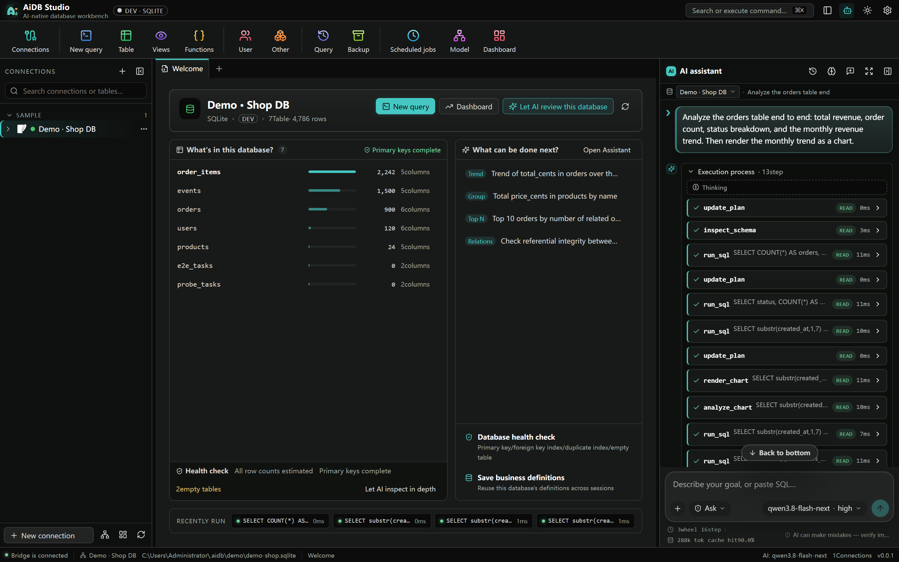 | 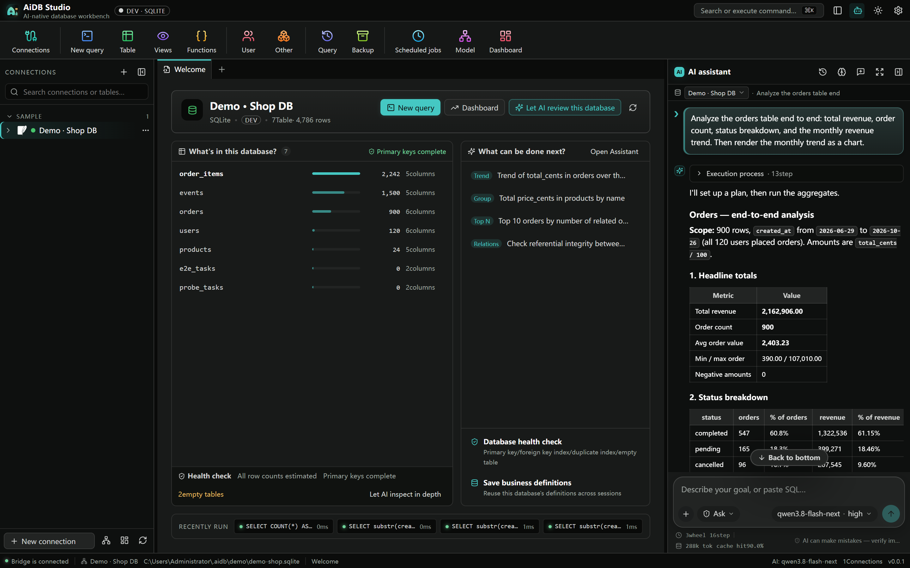 |

| Live chart from the Agent | Full Agent panel |
|---|---|
| 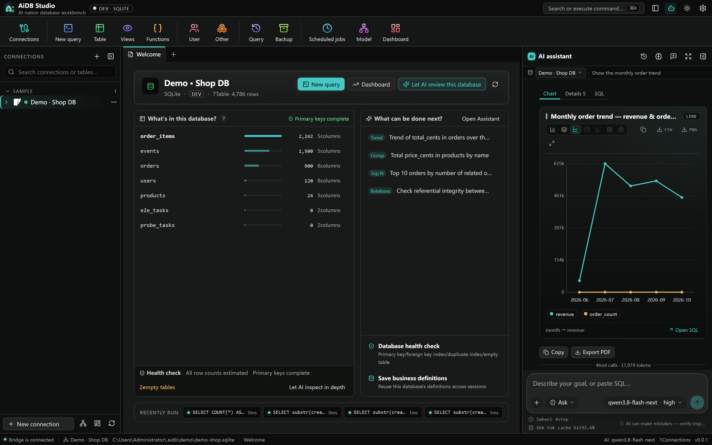 | 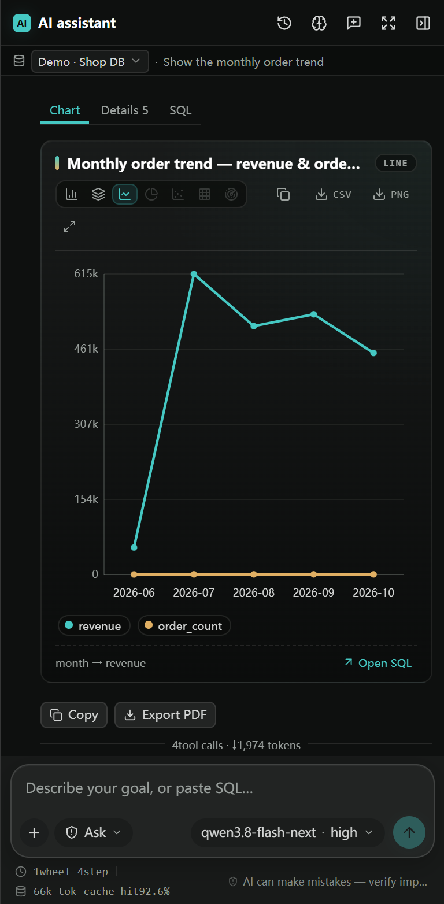 |

- **Approval is a hard gate**: schema changes pause for an explicit decision, with the exact tool, arguments, risk, and scope on screen.
- **Forecasts carry their method**: the Agent explains the model, fit quality, and interval instead of dropping a line on a chart.
- **Every step is auditable**: tool name, arguments, risk class, duration, token usage, and cache hit rate stay attached to the answer.

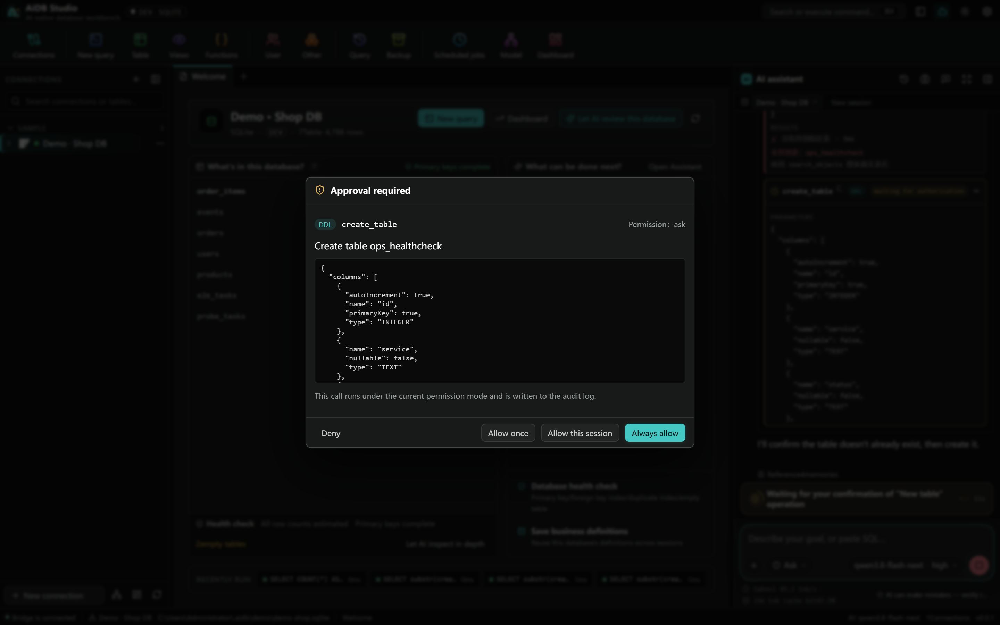

## Agent first

The hard part of putting AI inside a database tool is not the model integration. It is giving the model the same working conditions as a senior engineer: see the real schema, get real data, execute real SQL, and own the outcome.

AiDB puts the Agent on the main path of the task, not in a sidebar. Here, the Agent is not the last item in a feature list — it is how every feature is organized.

- **One execution surface**: The Agent sees the same connections, schema, data, and executor as the user. There is no second, looser entry point.
- **One risk boundary**: Read-only mode, approvals, backups, and audit are hard executor constraints, not suggestions inside a prompt.
- **One context**: Schema, business glossary, Agent context, long-term memory, and the `AI_DB.md` handoff document together determine how the Agent understands your database.
- **Deliverable results**: Answers are not the endpoint. Charts, reports, repair plans, and reconciliation diffs can be saved, refreshed, and exported.
- **Compounding experience**: Session memory, long-term memory, and manually curated business semantics mean the next task does not start from zero.

| Layer | What the Agent gets |
|---|---|
| Intent | Natural language, `@table`, images, slash commands, and command workflows |
| Execution | 53 tools covering queries, writes, DDL, transactions, charts, health audits, comparison, migration, and data flows |
| Context | Real schema, business aliases, glossary, example SQL, long-term memory, and candidate-table retrieval for large databases |
| Control | Read-only / ask / auto / full-auto, approvals, backups, audit, and execution traces |
| Delivery | Charts, PDF, dashboard cards, reports, Excel / PPTX, and rerunnable artifacts |
| Extension | Skills, MCP, web search, bot notifications, and external systems |

## Capabilities at a glance

- **53 Agent tools**: queries, schema changes, data writes, charts, health audits, comparison, migration, data flows, Skills, and MCP.
- **6 command workflows**: `/report`, `/compare`, `/diff`, `/recon`, `/fix`, `/ask`, plus `/init` for a database handoff document.
- **41 database engines**: relational, document, key-value, graph, vector, search, wide-column, and time-series.
- **14 toolbox modules**: reports, data flow, search, query builder, schema sync, data comparison, transfer, generation, monitoring, automation, users, dictionary, advanced objects, and Agent context.
- **7 chart types**: bar, stacked bar, line, pie, scatter, heatmap, and radar; line charts support forecast intervals and dual axes.
- **4 permission modes**: read-only, ask, auto, and full-auto; read-only connections are enforced server-side.

## Contents

- [Agent in action](#agent-in-action)
- [Agent first](#agent-first)
- [Capabilities at a glance](#capabilities-at-a-glance)
- [Quick start](#quick-start)
- [AI Agent](#ai-agent)
- [Reports and command workflows](#reports-and-command-workflows)
- [The workbench](#the-workbench)
- [Connections and engines](#connections-and-engines)
- [Object tree and database operations](#object-tree-and-database-operations)
- [Data grid](#data-grid)
- [SQL workbench](#sql-workbench)
- [Table designer and relationship diagram](#table-designer-and-relationship-diagram)
- [Dashboard](#dashboard)
- [Toolbox](#toolbox)
- [Mobile](#mobile)
- [Settings](#settings)
- [Integrations: notifications, Skills, MCP, web search](#integrations-notifications-skills-mcp-web-search)
- [Architecture](#architecture)
- [Commands](#commands)
- [Security model](#security-model)
- [Design boundaries](#design-boundaries)
- [Design documents](#design-documents)

## Quick start

Requires **Node.js ≥ 22.13** (the Bridge uses the built-in `node:sqlite`, which needs the 22.13+/23.4+ runtime) and npm 10+.

```bash
npm install
npm run dev
# Web UI:  http://localhost:5180
# Bridge:  http://127.0.0.1:8787
```

On first launch, a sample e-commerce database is created and seeded at `~/.aidb/demo` (users / products / orders / order_items / events). Open **Demo · Shop DB** in the left sidebar to try SQL, charts, and AI questions immediately.

Desktop app:

```bash
npm run dev:desktop    # Bridge + Vite + Electron
npm run build:desktop  # Package an installer for the current platform
```

Mobile:

```bash
npm --workspace apps/mobile run start    # Expo Go / simulator
npm --workspace apps/mobile run web      # Browser preview
npm --workspace apps/mobile run android  # Local Android project
```

Mobile pairing: on desktop, go to **Settings → Bridge → Pair a mobile device** to generate a QR code and a 6-digit pairing code. Scan the code, enter the pairing code, or connect through the `aidb://pair` deep link / same-network discovery. Once paired, both ends share connections, sessions, memory, and model settings.

> The Bridge binds to `127.0.0.1` by default. For public or reverse-proxy deployments, set `AIDB_PUBLIC_URL=https://db.example.com` and read the [security model](#security-model).

## AI Agent

The Agent's capability is not a claim of "natural language support." It is defined by six things: what it can see, what it can do, what constrains it, what it remembers, how it delivers, and how it extends. A task moves through six phases inside AiDB — understand, plan, execute, verify, deliver, retain — and every step leaves UI evidence.

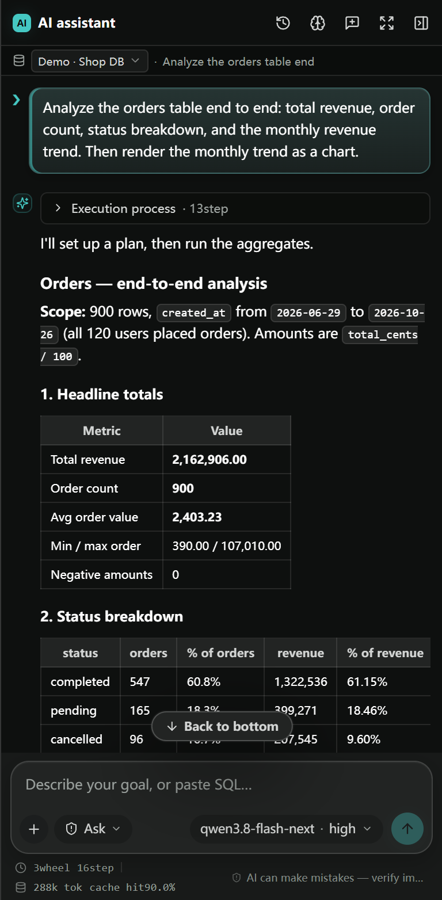

### What it finishes end to end

- **Data Q&A**: Starts from a business question, confirms definitions, selects tables, writes SQL, validates results, and returns conclusions, charts, and baselines instead of a wall of SQL.
- **Health audit and repair**: Checks primary keys, foreign-key indexes, duplicate indexes, empty tables, and data quality; produces a graded repair plan; backs up before execution and verifies after.
- **Schema changes**: Creates tables, alters columns, manages indexes, collections, and document writes; schema changes refresh the object tree and data pages.
- **Comparison and migration**: Cross-database schema diff, row-level reconciliation, and cross-connection data transfer, with confirmable and reviewable difference lists.
- **Delivery**: Turns analysis into saved charts, dashboard cards, reports, Excel / PPTX, or PDF instead of leaving it in chat history.

### How it works

- **Claude Code–style conversation**: `❯` user messages, `⏺` tool cards, collapsible parameters / results / SQL, Todo plan, execution stats, collapsible reasoning, and a completion summary.
- **Activity strip**: Shows "understanding the question / breaking down the task / running tools / waiting for approval / assembling results" in real time, not just a spinner.
- **Plan**: `update_plan` drives the checklist with live ✓ / ◐ / ○ states; expandable at any time.
- **Tool trace**: Parameters, results, duration, SQL, and errors for every call; results can open in the editor.
- **Smart scrolling**: Follows new output only when you are at the bottom; when you scroll up, a "back to latest" button appears instead of yanking you down.
- **Follow-up suggestions**: After each turn, offers clickable next questions based on the tables involved, generated locally with no extra tokens.
- **Model and effort**: Capsules at the bottom of the composer switch model and reasoning effort; effort comes from the current model profile.
- **Permission capsule**: Read-only / ask / auto / full-auto can be switched at any time; the current mode is always visible.
- **@ references**: `@table` injects schema into context; multiple tables and databases are supported.
- **Image attachments**: Up to 4 images per message; picker and removal are supported.
- **Sessions**: Isolated by connection + database, auto-resume the latest session for that database, search, rename, delete, archive / restore.
- **Export**: Answers export to PDF with chart backgrounds preserved in print styles; copying is also supported.
- **Interrupt**: Stop the current turn; output already produced is kept, and the running tool is marked aborted after it finishes.

### Toolset: 53 executable actions

| Group | Tools |
|---|---|
| Connections and schema | `list_connections`, `inspect_schema`, `search_objects`, `get_query_history` |
| SQL execution and transactions | `run_sql`, `explain_sql`, `sample_rows`, `profile_column`, `begin_transaction`, `commit_transaction`, `rollback_transaction` |
| Multi-dialect statements and retrieval | `run_mql`, `run_redis`, `run_cypher`, `run_cql`, `run_aql`, `search_index`, `vector_search` |
| Collections and documents | `create_collection`, `delete_collection`, `upsert_document`, `import_documents`, `delete_documents`, `write_line_protocol` |
| Schema and data changes | `create_table`, `alter_table`, `drop_object`, `manage_index`, `import_csv`, `export_result`, `generate_data` |
| Analysis, charts, and audits | `audit_database`, `check_data_quality`, `render_chart`, `analyze_chart`, `forecast_chart` |
| Comparison and migration | `schema_diff`, `recon_data`, `transfer_data` |
| Data flows | `manage_pipeline` |
| Operations | `backup_database` |
| Planning and memory | `update_plan`, `memory_write`, `memory_search` |
| Skills | `skill_list`, `skill_read`, `skill_write`, `skill_run`, `skill_list_files`, `skill_worker_run` |
| MCP | `mcp_list_servers`, `mcp_list_tools`, `mcp_call` |

Tool inputs use JSON Schema (`additionalProperties: false`), with risk levels ordered `read < write < ddl < destructive`. Command-private tools (such as `compose_report` and `submit_fix_plan`) are only available inside their command and are not counted among the 53 global tools.

### Capability catalog: making boundaries explicit

Beyond tools, the system prompt injects a **capability catalog** built from 14 contracts in `packages/core/src/capabilities/*.json`. Each contract declares what a feature is, which fields it requires, which states it has, and whether an Agent tool exists:

- Features with a tool: name the tool, parameters, and state; the model calls it directly.
- Features without a tool: compressed to "guide the user to Toolbox → X", with an explicit ban on inventing parameters or claiming completion.
- The same contract drives Agent prompts, REST parameter validation, and UI form rendering.

### Permissions: capabilities are gated

| Mode | Behavior |
|---|---|
| Read-only | All writes rejected; read-only connections are enforced server-side |
| Ask | Reads run directly; writes and DDL need approval; destructive operations always need approval |
| Auto | Reads, writes, and DDL pass automatically; destructive operations still need approval |
| Full-auto | Everything passes; destructive operations in production still require confirmation |

Approvals support "allow once / allow for this session / always allow." Destructive operations in production always go through approval; MCP write tools require approval by default, and approval signatures include the path / URL, so approving one file never authorizes another path.

### Context and memory

- **Session memory**: Sessions are persisted and automatically compacted into summaries when they grow too long; archived sessions can be restored at any time.
- **Long-term memory**: Seven types — facts, preferences, schema, episodes, procedures, glossary, and SQL examples. Hybrid lexical + scoped scoring retrieval; deduplication, decay, pinning, editing, and forgetting.
- **Agent context**: Per-database table / column enablement, business aliases, descriptions, value meanings, manual relationships, glossary, and example SQL. All of it is injected into prompts and directly improves answer accuracy.
- **Disabled-table guardrails**: Disabled tables are hidden from prompts, and object-level tools such as `run_sql`, `sample_rows`, `inspect_schema`, `profile_column`, and `manage_index` reject them at execution time; metadata enumeration is blocked too.
- **Large-schema retrieval**: Above 150 tables or 2,500 columns, candidate-table retrieval activates, selects tables for the question, and adds one hop of related tables instead of stuffing the entire database into the prompt.
- **SQL auto-repair**: On failure, the error, real column names, and edit-distance suggestions are fed back to the model for up to 2 automatic repairs; repaired SQL still goes through the full permission and approval path.
- **`/init` handoff document**: Scans the current database and generates `AI_DB.md`, which later conversations load automatically; generated sections refresh on every `/init`, while manually written sections are preserved.

### Models and reasoning

Model configuration is **provider-centric**, not model-centric:

- Configure an API endpoint and key once per provider, then attach multiple models to it;
- Each model can define context window, max output, image input, and reasoning effort;
- Switch the current model and effort from the bottom of the AI composer without leaving the workspace;
- Supports **Local (offline)**, **Anthropic Messages API**, and **OpenAI-compatible endpoints** (DeepSeek / Qwen / Ollama / vLLM, etc.);
- Keys are stored encrypted. Without a key, the built-in Local Reasoner still demonstrates queries, table creation, indexes, backups, exports, and memory.

### Execution guardrails

- The Bridge binds to `127.0.0.1` by default; mobile pairing issues revocable device tokens.
- Static SQL risk classification, automatic LIMIT, multi-statement statements disabled by default, and read-only enforcement.
- Automatic backup before destructive operations (configurable); every operation and approval is written to the audit log.
- The Agent and manual operations share the same executor and policy layer; there is no bypass.
- Skills run in a declarative permission sandbox; external MCP processes require explicit configuration; the built-in filesystem / Git / Web servers enforce directory allowlists, domain restrictions, and size limits.

## Reports and command workflows

The Agent's main path is not only free-form chat. AiDB distills high-frequency business actions into commands: a command defines the goal and the deliverable, while the Agent gathers evidence from the real database, executes, and organizes the conclusion. Parameters are inferred from semantics, context, and the existing schema rather than stacked forms. Commands run inside the conversation on desktop; mobile provides equivalent command workflows.

A command is not a menu — it is a task contract that defines the risk ceiling, available tools, execution method, and final artifact. Every Agent run leaves steps, evidence, and a rerunnable result.

| Command | Purpose | Output |
|---|---|---|
| `/report` | Builds a conclusion-first business report for a topic, time range, and audience; numbers carry same-definition baselines | A report that can be saved, refreshed, and exported to Excel / PPT |
| `/compare` | Same-definition comparison across two periods, groups, queries, or data sources | Comparison conclusions, metrics, and charts |
| `/diff` | Schema differences between two databases and target-dialect DDL | A schema difference list that can be confirmed and synchronized |
| `/recon` | Row-level reconciliation between two sources, including SQL tables and Redis key spaces | Count / key-level / field-level differences with executable fixes |
| `/fix` | Database health audit, repair plan, and safe execution | Audit summary, risk grading, repair SQL, backup, and verification |
| `/ask` | Talk to the Agent directly without starting a command | Free-form Q&A |
| `/init` | Scans the current database and generates an `AI_DB.md` handoff document | Engines and scale, business map, core table handbook, join paths, metric definitions, performance pitfalls, and a full inventory |

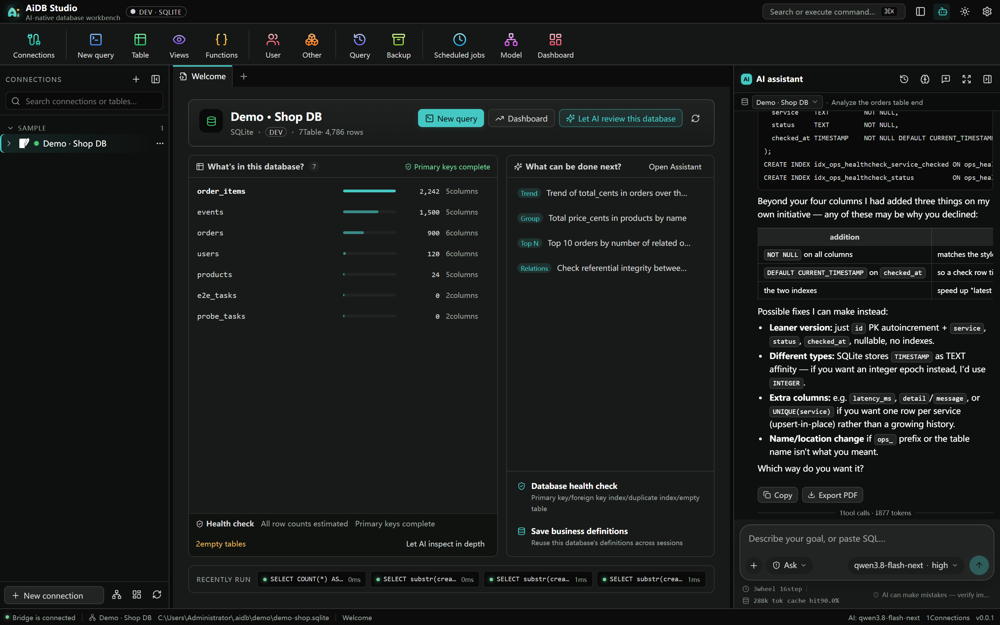

Reports and artifacts are persisted:

- **Reports**: summary, 2–5 sections, per-section conclusions, metric baselines, charts, tables, and action items; save and rerun to refresh.
- **Artifacts**: reports, comparisons, schema diffs, reconciliations, and audits all have `artifact + run` history; every run's status and results are visible.
- **Export**: reports support XLSX / PPTX; installing the PPT Master Skill enables native AI-generated PPTX.
- **Scheduled runs**: artifacts can be bound to a fixed interval, rerun automatically, and push summaries to notification channels.
- **Audit loop**: every issue found by an audit or quality check comes with executable SQL that can open in the editor; repairs follow backup, dry-run, approval, and verification.

## The workbench

The workbench is not an accessory to the Agent — it is the reality the Agent reasons about. Connections, object tree, data, SQL, designer, dashboards, and reports form an execution surface the Agent can observe, operate, and verify; users start tasks, inspect the process, and take over results in the same interface.

### Welcome: home for the current database

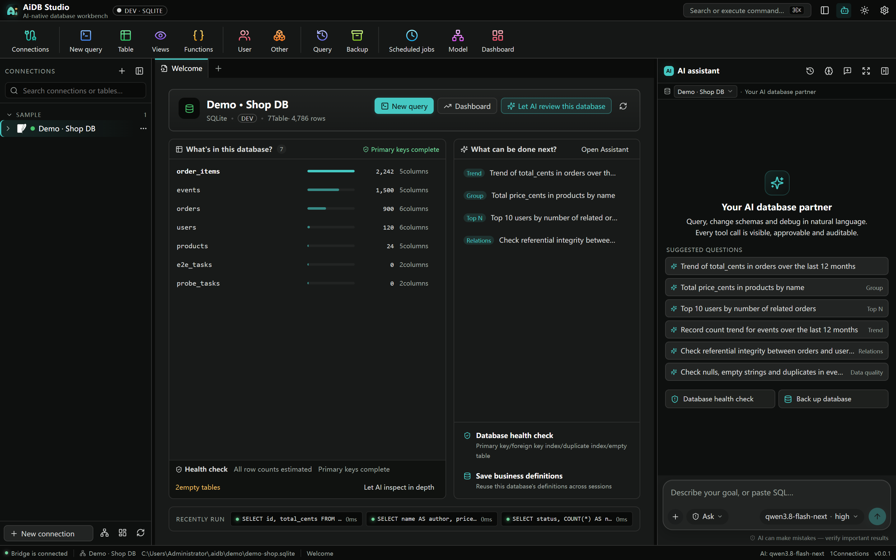

The first screen is the workbench for the **current connection + current database**, not a global dashboard:

- **Current database header**: connection name, database name, engine, environment tag, read-only marker, table / view / estimated-row counts; multi-database connections can switch the current database in place.
- **What is in this database**: tables sorted by row count, with column counts, row counts, and no-primary-key markers; views are labeled separately.
- **Audit summary**: primary-key coverage / missing keys, empty tables, and row-estimate coverage, directly below the table list.
- **What you can do next**: clickable AI suggestions generated from the current schema (trends, grouped statistics, Top N, referential integrity, etc.) that open the Agent.
- **AI shortcuts**: database audit, distill business definitions, new query, open dashboard; an empty database offers "let AI create tables."
- **Recently run**: recent queries filtered to the current database; click to load one into the SQL editor.
- **Scope separation**: the home page and the Agent each target their own database; when they differ, the UI says so and offers one-click alignment.

### Main workspace

The main workspace is a high-density, Navicat-style environment:

- **Ribbon**: connections, new query, tables, views, functions, users, other, query, backup, automation, models, and dashboards — 12 entry points.
- **Tabbed workspace**: data, query, designer, relationship diagram, and dashboard each get a tab; right-click to close, close others, or close all.
- **Command palette**: `⌘/Ctrl + K` to search or run commands, open connections, run backups, and switch themes.
- **Draggable layout**: the sidebar and AI panel can be resized and collapsed; the AI panel expands to 58% width.
- **Status bar**: Bridge status, current connection and database, current tab, current model, and connection count.
- **Theme and language**: dark / light / follow system, Chinese / English switched instantly.
- **Auto-refresh**: the Bridge emits `schema_changed`; the object tree, data page, and designer invalidate and refresh after schema changes. When the designer detects a concurrent change, it offers to reload or keep local edits.

Common shortcuts:

| Shortcut | Action |
|---|---|
| `⌘/Ctrl + K` | Command palette |
| `⌘/Ctrl + T` | New query |
| `⌘/Ctrl + B` | Show / hide the connection sidebar |
| `⌘/Ctrl + Shift + A` | Show / hide the AI assistant |
| `⌘/Ctrl + Shift + L` | Focus the AI composer |
| `⌘/Ctrl + W` | Close the current tab |
| `⌘/Ctrl + ,` | Open settings |
| `F5` | Refresh the current connection schema |
| `⌘/Ctrl + Enter` | Run the current statement in the query page |

## Connections and engines

41 engines are not a support list — they are 41 places the Agent can enter. Connection definitions, protocol capabilities, read-only rules, and SSH boundaries are shared exactly between users and the Agent; the Agent gets no looser entry point.

The connection form switches default port, database field, SSL / SSH capability, and test method per engine.

- **Connection properties**: name, color, environment tag (DEV / STG / PROD), group, notes, read-only, SSL, and SSH tunnel (password or private key).
- **Credential security**: connection passwords, SSH private keys, model keys, notification webhooks, and MCP environment variables are encrypted with AES-256-GCM; list APIs return redacted information only.
- **Test connection**: validates driver, network, and authentication before saving.
- **Read-only connections**: writes are blocked by the Bridge server-side, for both the Agent and manual operations; the status bar and connection tree mark them.
- **Connection / database memory**: each connection remembers its last database and sidebar expansion state and restores them on switch; the app never expands or switches to a database the user did not choose.
- **No credential distribution**: mobile reads connection configuration only; database passwords and SSH private keys are never sent to the phone.

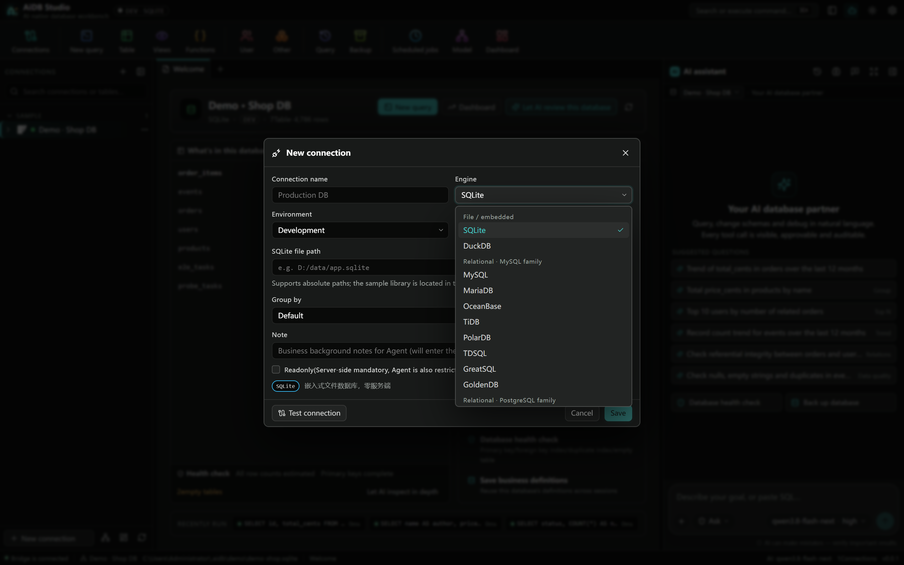

### 41 supported engines

| Family | Engines |
|---|---|
| File / embedded | SQLite, DuckDB |
| MySQL protocol | MySQL, MariaDB, OceanBase, TiDB, PolarDB, TDSQL, GBase 8a, Apache Doris, StarRocks, GreatSQL, GoldenDB |
| PostgreSQL protocol | PostgreSQL, TimescaleDB, CockroachDB, KingbaseES, openGauss, GaussDB, HighGo, Vastbase, IvorySQL |
| Enterprise / columnar | SQL Server, Oracle (thin), ClickHouse, DM8 |
| Document | MongoDB |
| Key-value | Redis |
| Graph | Neo4j, Memgraph, FalkorDB, ArangoDB |
| Vector | Qdrant, Milvus, Weaviate |
| Search | Elasticsearch, OpenSearch |
| Wide-column | Cassandra, ScyllaDB |
| Time-series | TDengine, InfluxDB |

Protocol aliases reuse the same driver but keep their own default ports and capability boundaries: DM8 uses the official `dmdb`, DuckDB uses a file driver, and OceanBase currently connects in MySQL mode only. Object tree, query language, DDL, backup, user management, and transactions are trimmed per engine; unsupported features are explicitly disabled instead of offering a button that will fail.

> **The macOS Intel and Windows arm64 installers ship without the Oracle driver.** Upstream `node-oracledb` 26 publishes prebuilt bindings for `darwin-arm64` / `linux-arm64` / `linux-x64` / `win32-x64` only — there is no `darwin-x64` or `win32-arm64`. Thick mode loads the same binding, so installing Oracle Instant Client does not work around it. The Bridge reports engines that lack a binding for the current machine in `unavailableEngines` on `/health` and `/bootstrap`; the desktop app greys Oracle out in the new-connection dialog and states the reason instead of letting the connection fail later. The other 40 engines behave identically on those two builds.

### Non-relational workbenches

- **MongoDB**: collection browsing, sampled field inference, `collection / op / filter / pipeline` JSON queries, document writes, single-document editing, CSV import, collection and index creation/deletion, and TTL / unique / sparse indexes.
- **Redis**: DB index switching, SCAN key browsing, String / Hash / List / Set / ZSet viewing, command console, and key creation.
- **Cassandra / ScyllaDB**: keyspace / table browsing and a CQL console.
- **Neo4j / Memgraph / FalkorDB / ArangoDB**: node label and relationship type browsing, Cypher / AQL console, and a force-directed graph view.
- **Qdrant / Milvus / Weaviate**: collection and dimension browsing, vector search panels; collection lifecycle, payload indexes, and field expansion are exposed per engine capability.
- **Elasticsearch / OpenSearch**: index / mapping browsing, `_search` JSON DSL, document writes, and index management.
- **TDengine**: super-table / sub-table browsing and a SQL console.
- **InfluxDB**: InfluxDB 3 SQL queries and a line-protocol write panel.
- **PostgreSQL + pgvector**: vector search panel and embedding configuration.

## Object tree and database operations

The object tree is both the user's map and the Agent's directory. It organizes connections, databases, schemas, tables, views, functions, and backups into one navigable object model; whatever a user does through the context menu, the Agent does through the same objects and executor.

The tree is organized as **connection → database / schema → table / view**, with fixed entry points for functions / stored procedures, queries, and backups.

- **Fast location**: search connections or objects, collapse by group, and remember expansion state; tables and views are grouped separately, with estimated row counts shown directly in the tree.
- **Database context menu**: close, edit / create / drop database, new table, new query, command column, run SQL file, dump SQL, reverse engineer to model, open dashboard, find in database, refresh.
- **Table context menu**: open, new query, design, new table, rename, copy (structure only / structure + data), view DDL, create shortcut (Windows), print table, maintain, object information, set privileges, import / export wizard, truncate, drop, reverse engineer to model, AI explain, AI data quality.
- **View context menu**: data, new query, view DDL, print, drop view, AI explain this view.
- **Connection context menu**: edit, test, refresh, new query, new table, design, relationship diagram, AI database audit, copy name, delete.
- **Create / drop database**: executed per engine capability; MySQL / MariaDB do not support renaming databases, SQLite / Oracle do not support creating or dropping databases, and the UI explains why.
- **Entry points outside the tree**: new connection, relationship diagram, dashboard, and refresh at the bottom; the Ribbon items "Tables / Views / Functions / Users / Other / Automation" open the corresponding workspaces.

### Database and table operations

- **Table maintenance**: analyze, optimize, check, repair, and reclaim space, shown per engine capability.
- **DDL view and copy**: both tables and views expose their DDL.
- **Copy table**: structure only, or structure + data.
- **Truncate / drop**: dangerous operations require a second confirmation, and production forces approval.
- **Import / export wizard**: the data page supports import preview and column mapping; export supports CSV / JSON / SQL / XML / XLSX.
- **Backup and restore**: logical SQL dump; restore from Settings → Data & Backups; destructive operations can back up automatically (on by default).

## Data grid

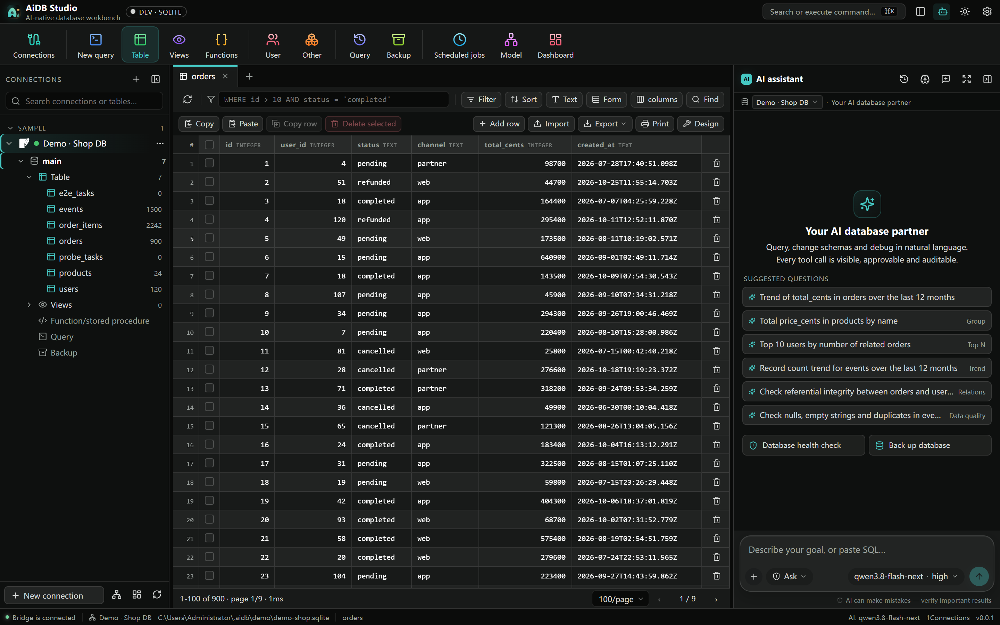

The data page is where users verify Agent results and where they edit data by hand. Both share the same pagination, filtering, sorting, and write semantics: when the Agent says "3 rows changed," the user can see those 3 rows in the same grid.

The data page is not a read-only table but a grid for everyday data maintenance:

- **Browsing**: row numbers, pagination, page size, record range and page number, double-click / form editing, text view, and form view (row-by-row editing).
- **Location**: WHERE filtering, a visual filter builder, a multi-column sort dialog, and safe single-row location by primary key.
- **Editing**: add row, delete row, multi-row selection, copy / paste (TSV), copy selected rows to the end of the table, batch delete, and find & replace (preview the match count before executing).
- **Column management**: hide columns, restore all columns, and auto-fit column width and content.
- **Non-relational**: MongoDB document editing, Redis key-value panels, vector search, and line-protocol writes.
- **Import**: CSV / TSV / TXT / JSON / XML / XLSX, with delimiter, header row, preview, and column mapping; up to 5,000 rows per batch, inserted in bulk.
- **Export**: CSV / JSON / SQL / XML / XLSX; large tables export up to a configurable limit.
- **Print**: print preview, printable from the browser / Electron, or saved as PDF.
- **Error handling**: a failed write preserves the original error and the current edit state; data is never silently dropped.

## SQL workbench

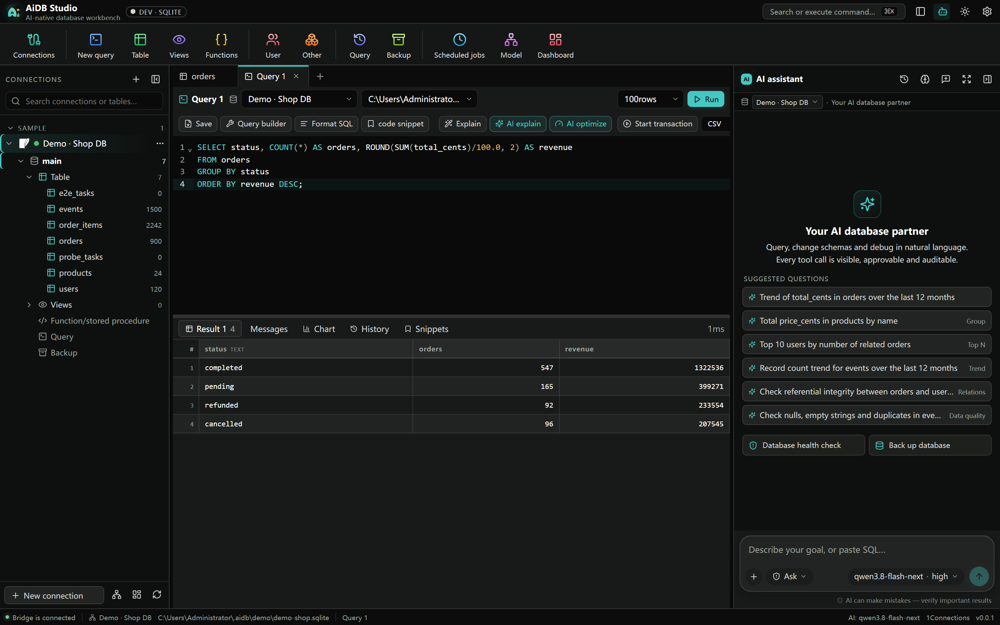

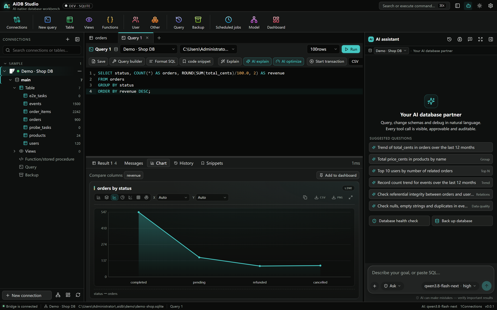

SQL remains the hard currency of database work. AiDB does not hide SQL; it makes SQL a language the Agent and the user edit and verify together. Statements written by the Agent can return to the editor, and SQL selected by the user can be handed to the Agent for explanation or optimization at any time.

- **Editor**: CodeMirror 6 with dialect highlighting (SQLite / MySQL / PostgreSQL / SQL Server / Oracle / ClickHouse; standard SQL elsewhere) and autocomplete for the current connection's tables and columns.
- **Execution**: `⌘/Ctrl + Enter` runs the current statement, or only the selection when text is selected; full scripts, multiple result sets, and a messages panel; optional auto-LIMIT and multi-statement switches.
- **Connection and database**: switch both inside the page, with completion based on the current database schema.
- **Transactions**: engines supporting `BEGIN / COMMIT / ROLLBACK` can start, commit, and roll back inside the page; the transaction stays on one Bridge-side connection.
- **Results**:
  - Table results with copy, multiple result sets, and export to CSV / JSON / SQL / XML / XLSX;
  - Chart results with bar / stacked bar / line / pie / scatter / heatmap / radar, X / Y switching, comparison columns, dual axes, CSV / PNG export, zoom, and the underlying SQL;
  - Graph database results automatically switch to a graph view;
  - Query results pin to the current database's dashboard in one click.
- **Assistance**: format SQL, execution plan, query history (search / favorite / reload), SQL snippet library, save / open `.sql` files, and a visual query builder.
- **AI Copilot**: with SQL selected, "AI explain" or "AI optimize" sends it to the Agent, which returns rewritten SQL, precise index DDL, and verification queries.
- **Multi-language modes**: MongoDB switches to MQL JSON, Redis to command mode, graph databases to Cypher / AQL, Cassandra to CQL, search to `_search` DSL, and vector databases to vector-search JSON; SQL-only tools are hidden.

## Table designer and relationship diagram

A schema change is not a single DDL statement; it is an engineering action that needs preview, confirmation, and pre-execution review. The designer turns columns, indexes, foreign keys, triggers, and options into a reviewable model, while the relationship diagram maps dependencies between tables.

- **Visual table design**: seven tabs — columns, indexes, foreign keys, triggers, options, comments, and SQL preview.
- **Live DDL preview**: changing a column, type, default, nullability, comment, or index generates target-dialect DDL in real time for review before execution.
- **Concurrent schema changes**: when an external change is detected, the designer offers to reload or keep local edits, preventing silent overwrites.
- **Relationship diagram**: a read-only ER view based on foreign keys, with schema cards and edges; click a table to open its data; export to SVG.
- **Model entry points**: reverse engineer to model from a connection / database / table context menu.

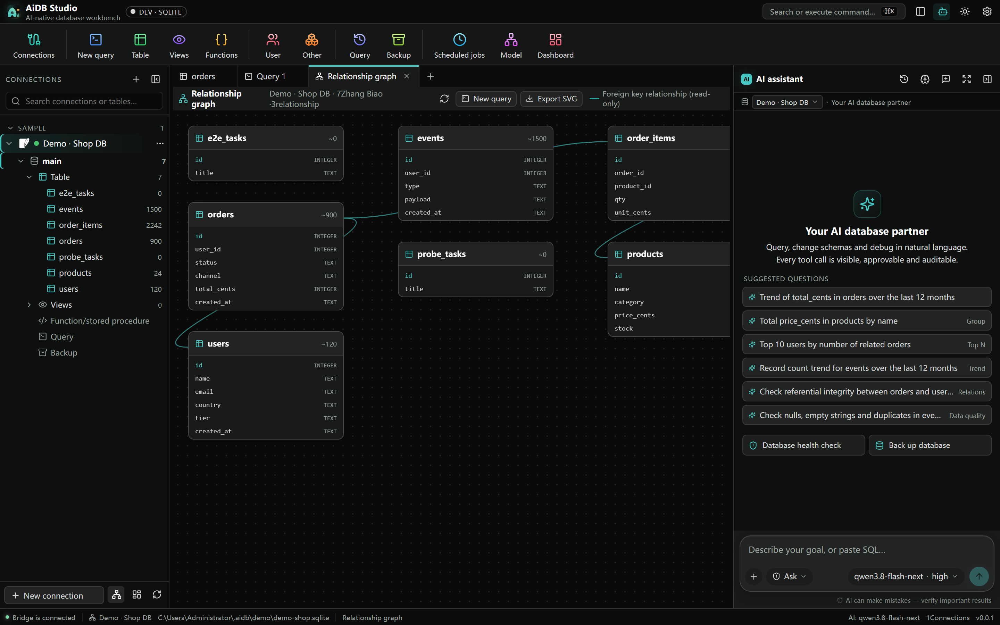

## Dashboard

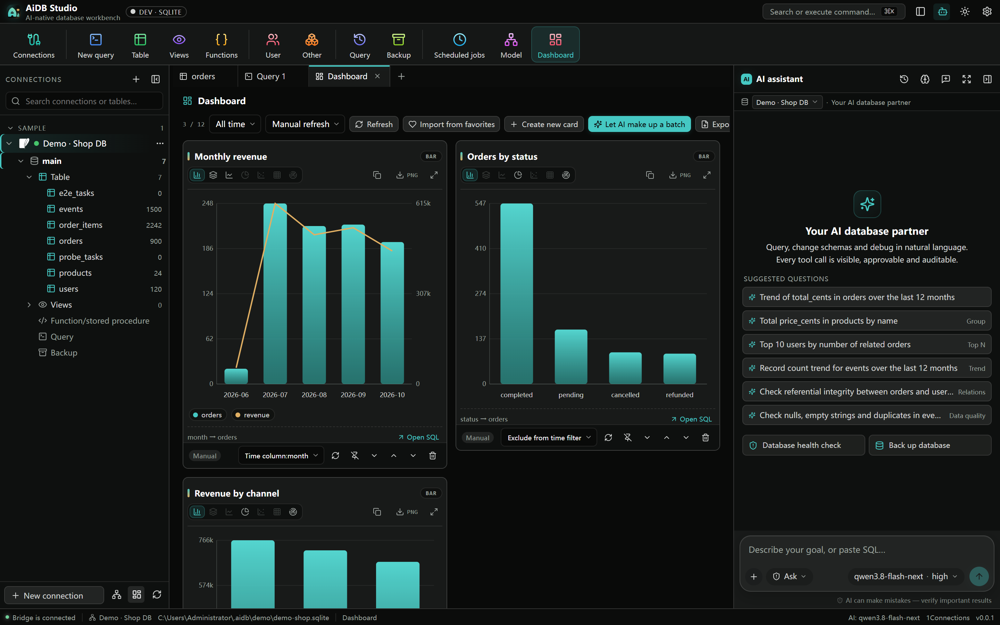

The dashboard turns the Agent's analysis from a one-off answer into cards that stay observable. It stores SQL, not screenshots; opening it renders the last snapshot first, then reruns in the background so conclusions keep pace with the database.

The dashboard is a **frequently asked questions panel for this database**, not a BI canvas:

- **Per-database isolation**: scoped to `connectionId + database`, one board per database.
- **Live cards**: cards store SQL, not screenshots; opening renders the last result snapshot, then re-executes in the background.
- **AI drafts vs pinned cards**: AI-generated cards are drafts (`pinned = 0`) and can be discarded in bulk; user-pinned cards (`pinned = 1`) are never overwritten by AI.
- **Three sources**: ask AI for a batch, import from favorite queries, or write SQL manually; one sentence can generate a single card and a trial run.
- **Board controls**: all time / last 7 days / last 30 days / last 90 days / last year; scheduled refresh (5 minutes / 30 minutes / 2 hours / daily); per-card refresh, widen / narrow, pin, and delete.
- **Export for reporting**: turn current card results into a paginated report (PPTX), or use `/report` for a fuller business report.
- **Read-only guardrails**: dashboard SQL must be read-only, auto-LIMIT applies, disabled tables are blocked at execution, and all card metadata is written only to `~/.aidb`, never to the target database.

## Toolbox

The toolbox lives under the Ribbon's "Other" tab; all 14 modules share the same Bridge and permission model. Each module has a capability contract declaring fields, types, constraints, and states, which simultaneously drives the Agent capability catalog, REST validation, and UI form rendering.

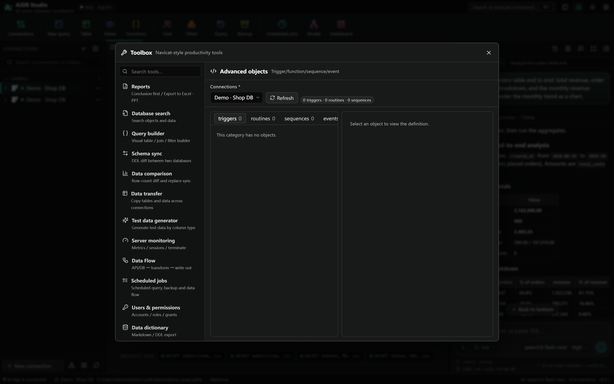

This means the Agent does not merely "see that these buttons exist"; it knows which parameters each module needs, which states it returns, and which actions the user must perform personally. Capability contracts separate "can the model use it" from "does the feature exist," preventing the model from inventing a nonexistent API.

| Module | Capability | Agent availability |
|---|---|---|
| Reports | Conclusion-first reports by topic, time range, and audience; save, refresh, export Excel / PPT | `/report` command + command-private tools |
| Database search | Full-text search across object names / comments and text data columns; open results directly | `search_objects` (object names only) |
| Query builder | Select tables, joins, columns, WHERE, sort, and row limit; generate SQL into the editor | No dedicated tool (`run_sql` equivalent) |
| Schema compare & sync | DDL diff between two connections, target-dialect SQL, execute after confirmation | `schema_diff` (comparison only) |
| Data comparison | Row-count + primary-key fingerprint differences; per-table replace sync | No dedicated tool (`recon_data` covers row-level reconciliation) |
| Data transfer | Copy table schema and data across connections, auto-create tables, append / clear-then-write | `transfer_data` |
| Data generation | Generate 1–5,000 test rows from column semantics, types, and foreign keys; preview then insert | `generate_data` |
| Data flow | Pull from an HTTP API or a SQL query, reshape with JSONPath / expressions, compute in embedded DuckDB or a JS / Python script, then write to a table or push to an API; preview a single step, keep an incremental bookmark | `manage_pipeline` |
| Server monitoring | Engine metrics and session list, refreshed every 10s; kill sessions | No |
| Automation | Scheduled SQL / backup / data-flow tasks, minimum 30s interval; run now, enable / disable, status | No |
| Users and privileges | Account / role lists, create, drop, grant | No |
| Data dictionary | Markdown / DDL / JSON export with column types, defaults, and comments | No |
| Advanced objects | Triggers / functions / stored procedures / sequences / events and their definitions | No |
| Agent context | Table / column enablement, business aliases, descriptions, manual relationships, and glossary | Read implicitly injected; writes intentionally not exposed |

Features without an Agent tool never let the model pretend to execute: the capability catalog requires it to guide the user to the corresponding toolbox module.

## Mobile

The Agent should not be pinned to the desktop. Mobile brings the same Agent to the phone through the Bridge: the same connections, sessions, memory, models, and permissions, so work can continue on a commute, in a meeting, or in the field.

Mobile is not a shrunken desktop — it is a complete pocket workspace.

<p align="center">
  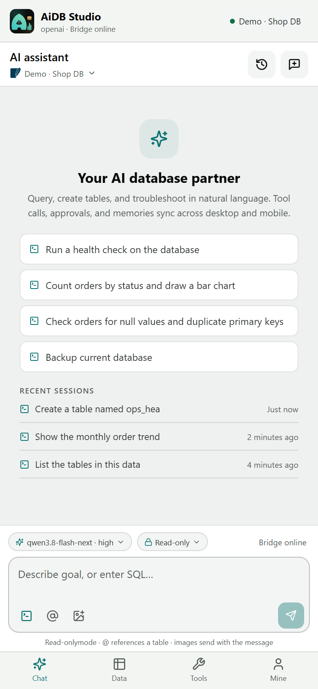
  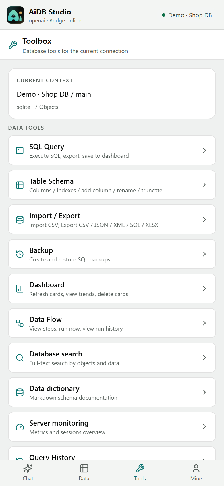
  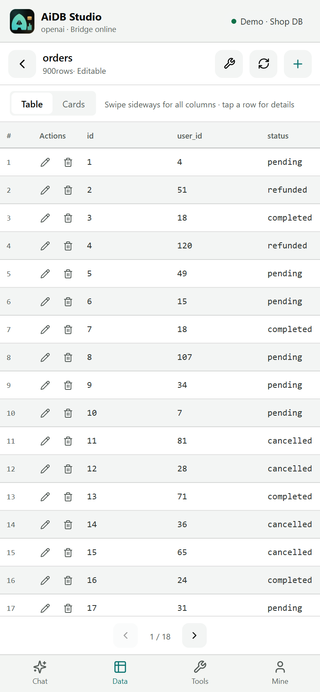
</p>

- **Pairing**: QR code, 6-digit pairing code, `aidb://pair` deep link, native mDNS discovery / same-network scan; credentials live only in secure device storage.
- **Top-level navigation**: Chat / Data / Tools / Me.
- **Chat**: model and reasoning effort, permission mode, database switching, @ table references, image attachments, session search / rename / delete / archive, and memory CRUD.
- **Data**: connection + database selection, table / card views, horizontal scrolling for all columns, edit / delete by primary key, add rows, and pagination.
- **Tools (12 database tools)**: SQL query, table schema, import / export, backup, dashboards, database search, data dictionary, server monitoring, query history, audit log, reports and artifacts, and users and privileges.
- **SQL**: multi-statement switch, result table, export to CSV / JSON / XML / SQL / XLSX, and save as a dashboard card.
- **Table schema**: view columns / indexes, add columns, create / drop indexes, rename, truncate, drop table, and visual table creation.
- **Import / export**: CSV import; CSV / JSON / XML / SQL / XLSX export; web download and native sharing.
- **Backup**: backup list, back up now, and restore (with confirmation).
- **Dashboards**: card list, refresh, mini trends, and delete; card layout editing remains on desktop.
- **Reports and artifacts**: view spec / run results, export XLSX / PPTX, and delete.
- **Command workflows**: render data sources, parameters, enums / booleans from the command definition; start and poll for results.
- **Me**: connection list, memory, paired devices, theme (dark / light / follow system), language (Chinese / English), Skills / MCP switches, and unpair.
- **Charts**: bar / line / pie / scatter / heatmap / radar with the same palette and heatmap scale as desktop.
- **Read-only by default**: mobile starts in read-only mode and can switch explicitly; database credentials are never sent to the device.

> Browser QR scanning requires HTTPS (or localhost); for LAN HTTP pages, enter the Bridge address manually or put the Bridge behind a TLS reverse proxy.

## Settings

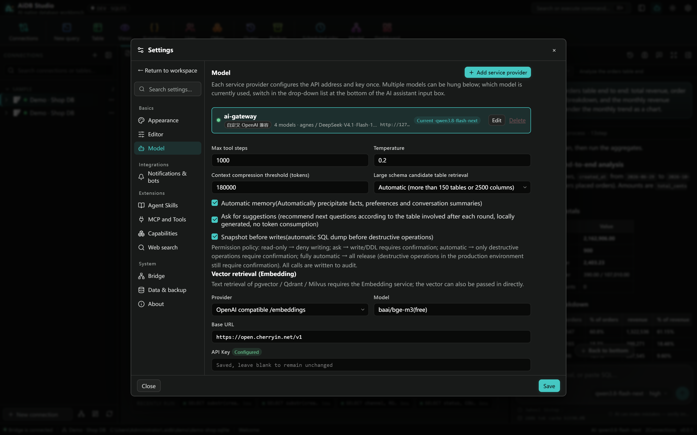

Settings determine the Agent's field of view, force, and boundaries: which model thinks, how many steps it can take, whether it remembers automatically, whether it backs up before writes, which Skills and MCP servers are available, and where search results come from. This is not a preferences page — it is part of the Agent's behavior.

Settings has 11 sections:

| Section | Contents |
|---|---|
| Appearance | Dark / light / follow system, Chinese / English |
| Editor | Default row limit, query timeout, history retention count / days, multi-statement switch, auto-LIMIT |
| Models | Providers and multiple models, API endpoint / key, model profiles (context, output, images, reasoning effort), temperature, max steps, auto-memory, follow-up suggestions, backup before writes, large-schema retrieval, embeddings |
| Notifications and bots | Outbound Feishu, WeCom, DingTalk, Slack, Discord, Telegram, QQ (OneBot); inbound read-only Q&A for Feishu / OneBot |
| Agent Skills | Enable / disable, install, inspect files, run tasks, secrets, and output files |
| MCP and tools | stdio MCP servers, 3 built-in servers, and the Agent tool catalog |
| Capability contracts | Fields, states, and tool mappings for the 14 contracts |
| Web search | Enablement, keys, proxies, health telemetry, and probes for 12 search backends |
| Bridge | Mobile pairing QR code / code, paired devices, and revocation |
| Data and backups | Recent audit, export audit CSV, backup list, and restore |
| About | Version, license, and dependencies |

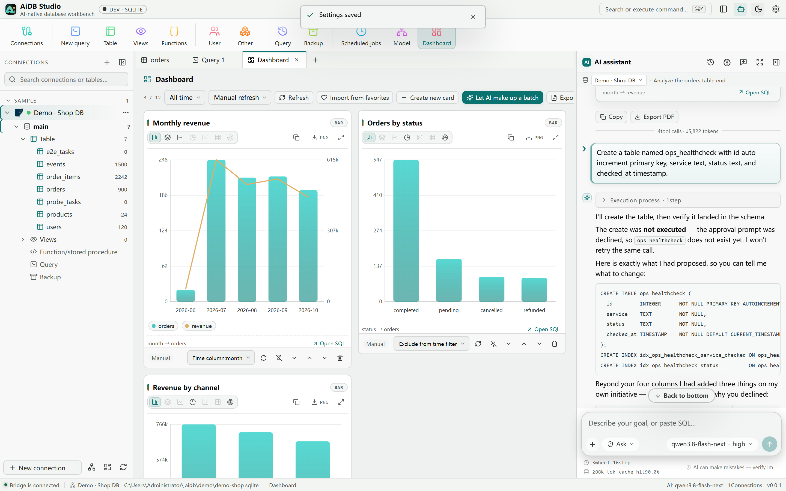

## Integrations: notifications, Skills, MCP, web search

The Agent's value extends beyond the database. Notifications, Skills, MCP, and web search extend its reach into external systems while keeping permissions and audit inside the Bridge.

### Notifications and bots

- **7 outbound platforms**: Feishu, WeCom, DingTalk, Slack, Discord, Telegram, and QQ (OneBot HTTP).
- **Inbound read-only Q&A**: Feishu event callbacks and OneBot message events can trigger a read-only Agent and reply in place; WeCom inbound is not supported yet.
- **Scheduled reports**: after an artifact completes, a summary is sent to the bound channels; a failure in one channel does not affect the others.
- **Audit**: every send records `notification.send`.

### Agent Skills

- **Built-in skills**: report writing, SQL review, and data dictionary; installed automatically on first launch.
- **Import methods**: local directory, zip, Git repository, or npm package; each Skill contains a `SKILL.md`.
- **Execution**: the Skill Host provides a declarative sandbox for file I/O, processes, Python packages, and network permissions; Worker sub-agents, secret injection, and output files are supported.
- **PPT Master**: after installing the third-party Skill with one click, reports can generate native PPTX with brand templates and quality gates.
- **Switch**: Settings → Agent Skills master switch; when off, skills remain manageable but the Agent no longer receives Skill tools.

### MCP

- **External MCP servers**: stdio JSON-RPC, lazy start, process reuse; tool discovery and invocation are supported.
- **3 built-in servers**:
  - `builtin-filesystem`: directory allowlist, realpath validation, read/write limits; `grep_files` prefers ripgrep;
  - `builtin-git`: read-only `status / log / diff / show` with a fixed argument allowlist;
  - `builtin-web`: `fetch_url` / `web_search`, blocking loopback, private network, link-local, and cloud metadata addresses.
- **AiDB as an MCP server (outbound)**: `scripts/aidb-mcp-server.mjs` exposes AiDB's read-only tools to external MCP clients.
- **Tool catalog**: Settings → MCP and Tools lets you search and browse all 53 Agent tools by group, including their risk constraints.

### Web search

12 backends fan out concurrently:

- No key required: Exa, Parallel (MCP), Bing (RSS), DuckDuckGo (HTML, proxy required), SearXNG (self-hosted);
- Key required: Brave, Tavily, Serper, Mojeek, DeepSeek, Anthropic, OpenAI.

Result URLs are deduplicated and relevance-reranked; failures are isolated per backend; each backend has health telemetry and a one-click probe; failure reasons distinguish DNS, timeout, proxy, and other issues. Only Exa / Parallel / Bing are enabled by default after reachability testing; the rest can be enabled as needed.

## Installers

Releases are published per operating system and architecture — six desktop combinations:

| System | Architecture | Files |
|---|---|---|
| Windows | x64 | `AiDB-Studio-<version>-x64-setup.exe` (NSIS) |
| Windows | arm64 | `AiDB-Studio-<version>-arm64-setup.exe` (NSIS) |
| macOS | Apple Silicon | `AiDB-Studio-<version>-arm64.dmg` |
| macOS | Intel | `AiDB-Studio-<version>-x64.dmg` |
| Linux | x64 | `AiDB-Studio-<version>-x86_64.AppImage` / `-amd64.deb` / `-x86_64.rpm` |
| Linux | arm64 | `AiDB-Studio-<version>-arm64.AppImage` / `-arm64.deb` / `-aarch64.rpm` |

- Windows on ARM can also run the x64 installer through the system emulator, and that build keeps the Oracle driver.
- Linux filenames follow distribution conventions (x64 shows up as `amd64` or `x86_64`, arm64 as `aarch64`). deb and rpm install through the package manager; the AppImage is portable but needs FUSE 2 — otherwise run it with `--appimage-extract-and-run`. A graphical session is required either way; WSL2 needs WSLg.
- Each installer carries only its own architecture's native bindings (DuckDB, node-oracledb), asserted per build in CI; the two exceptions are described in the engine section above.
- Android and iOS are built through EAS and are not part of the release page.

### Checking for updates

Settings → About has a version card that asks GitHub for the newest release and then either installs it or points at the release page, depending on how the app was installed.

| Install form | Behaviour | Why |
|---|---|---|
| Windows (NSIS) | Downloads and installs silently, with differential download (`latest.yml` + blockmap — usually tens of KB instead of the full installer) | The installer supports `/S` and the install directory is writable |
| Linux (AppImage) | Same, using `latest-linux.yml` / `latest-linux-arm64.yml` | Only the AppImage can replace itself |
| Linux (deb / rpm) | Opens the release page | `/opt` belongs to the package manager |
| macOS | Opens the release page | The build is unsigned and Squirrel.Mac refuses to replace an unsigned app |
| Dev mode / web | Version check only | No `app-update.yml`, and no installed bundle to swap |

Auto-update relies on `latest*.yml` in the release (version, file name, sha512). Windows metadata carries no architecture suffix, so arm64 uses a separate `latest-arm64.yml` channel and the client picks the file matching `process.arch`; on Linux electron-updater appends `-linux-arm64` itself. Installer file names use hyphens throughout (`AiDB-Studio-...`): electron-builder rewrites spaces to `-` when writing the metadata, while GitHub rewrites them to `.` on upload, and the mismatch would 404 the download URL.

## Architecture

```
apps/desktop     Electron 45 + React 18 + Vite 6 (also runs in a plain browser)
apps/gateway     Bridge: drivers, metadata database, REST / SSE / WS, Agent host, scheduler
apps/mobile      Expo SDK 52 / React Native 0.76 (Android / iOS / Web)
packages/core    Platform-agnostic core: SQL classification and dialects, DDL, Agent runtime, tools, permissions, memory, providers, capability contracts
docs/            Design documents, verification reports, screenshots
scripts/         Documentation contracts, seed data, E2E, QA, standalone MCP server
```

- **Bridge**: the local gateway managing connections, drivers, metadata, executor, and the Agent runtime; bundled with desktop and deployable independently.
- **Metadata**: `~/.aidb/aidb.db` by default (connections, sessions, memory, artifacts, dashboards, audit, Skills, MCP, notifications, devices); sample databases in `~/.aidb/demo`; exports and backups in `~/.aidb/exports` / `~/.aidb/backups`.
- **Transport**: REST + SSE (desktop / web) + WebSocket (mobile and schema-change events).
- **Execution**: manual operations, Agent tools, command workflows, dashboards, and reports share the same ConnectionManager / ToolExecutor / policy layer.
- **Mobile**: never connects to databases directly; it reaches the Bridge over REST / WS, and connection credentials stay in the Bridge.

Deploy the Bridge independently with Docker:

```bash
docker build -f apps/gateway/Dockerfile -t aidb-bridge .
docker run -p 8787:8787 -v aidb-data:/data \
  -e AIDB_TOKEN=change-me \
  -e AIDB_PUBLIC_URL=https://db.example.com \
  aidb-bridge
```

## Commands

| Command | Description |
|---|---|
| `npm run dev` | Bridge (tsx hot reload) + Vite UI |
| `npm run dev:desktop` | Bridge + Vite + Electron |
| `npm run seed` | Create / validate the built-in sample SQLite database |
| `npm run seed:business` | Generate a retail business database and mirror (with schema drift and row-level differences) |
| `npm run typecheck` | Typecheck all four workspaces |
| `npm test` | Core unit tests + Bridge integration tests |
| `npm run build` | Core / Bridge bundle / desktop UI / mobile web |
| `npm run build:desktop` | Electron installer (Windows NSIS / macOS dmg / Linux AppImage + deb + rpm, x64 and arm64 each) |
| `npm run build:mobile` | Expo web export |
| `npm run e2e` | Headless browser: desktop web + mobile web + Electron shell |
| `npm run verify:docs` | Design document contracts |
| `npm run verify:controls` | Form control audit |
| `npm run verify` | Docs contracts → controls → types → tests → build → E2E |
| `npm run bench` | Agent accuracy benchmark |

## Security model

AiDB builds security into the Agent rather than patching it afterward. Read-only mode, approvals, backups, and audit are hard executor boundaries, not prompt-level suggestions.

- **Network boundary**: the Bridge binds to `127.0.0.1` by default; mobile exchanges a 6-digit pairing code for a revocable device token; `/pair/claim` is rate-limited by source.
- **Credentials**: connection passwords, SSH private keys, model keys, webhooks, and MCP environment variables use AES-256-GCM; a standalone Bridge derives its key from `AIDB_SECRET`.
- **Database boundary**: read-only connections are enforced server-side; SQL is statically classified; auto-LIMIT applies; multi-statement requests are denied by default; destructive operations in production require approval.
- **Agent boundary**: no shell; filesystem restricted by directory allowlists; network limited to model APIs / search backends / web MCP; every tool call passes through the policy layer.
- **Skill / MCP boundary**: Skills run in a declarative permission sandbox; external MCP servers require explicit configuration; the built-in filesystem / git / web servers enforce path, command, domain, and size limits.
- **Traceability**: manual and Agent operations both write to the audit log; approvals, duration, risk level, and affected SQL are searchable and exportable to CSV.

Reverse proxy example (Nginx forwarding `https://db.example.com` to `127.0.0.1:8787`):

```nginx
location / {
  proxy_pass http://127.0.0.1:8787;
  proxy_http_version 1.1;
  proxy_set_header Host $host;
  proxy_set_header X-Forwarded-Proto $scheme;
  proxy_set_header Upgrade $http_upgrade;
  proxy_set_header Connection "upgrade";
  proxy_read_timeout 900s;
  proxy_buffering off; # Agent SSE stream
}
```

When starting the Bridge, set `AIDB_PUBLIC_URL=https://db.example.com` so pairing QR codes and suggested addresses use the public URL directly.

## Design boundaries

- AiDB Studio is a Navicat-style database client, not a BI platform: dashboards are per-database question panels, without a free-form drag canvas, drill-down linking, or cross-source JOINs.
- Mobile is a pocket workspace: connection credentials are never distributed, and complex layout editing and some administration capabilities remain on desktop.
- Graph, vector, search, time-series, and wide-column engines work in their own query languages rather than forcing SQL semantics; unsupported DDL, backup, and user management are disabled.
- Data edits currently commit immediately; cross-request transactions use `BEGIN / COMMIT / ROLLBACK` on engines that support them.
- Desktop installers are produced per system and architecture (Windows / macOS / Linux × x64 / arm64); the macOS Intel and Windows arm64 builds ship without the Oracle driver, see the engine section above. Mobile IPA / APK builds need EAS and stay outside the release pipeline.

## Design documents

- [Product overview](docs/00-product-overview.md)
- [Technical architecture](docs/01-tech-architecture.md)
- [Feature specification](docs/02-feature-spec.md)
- [UI/UX design](docs/03-ui-ux-design.md)
- [AI Agent design](docs/04-ai-agent-design.md)
- [Data model and protocol](docs/05-data-and-api.md)
- [Delivery and verification](docs/06-delivery-and-verification.md)
- [Verification report](docs/07-verification-report.md)
- [Agent accuracy plan](docs/08-agent-accuracy-plan.md)
- [Multi-engine architecture](docs/09-multi-engine.md)
- [Real MySQL read-only regression](docs/10-real-mysql-readonly-regression.md)
- [Command-driven Agent workflows](docs/11-command-workflows.md)
- [Bots and MCP plugins](docs/12-bots-and-mcp.md)
- [Skill Host design](docs/13-skill-host-plan.md)
- [Dashboard design](docs/14-dashboard-design.md)
- [Command scoping](docs/15-command-scoping.md)
- [Capability contracts](docs/16-capability-contract.md)
- [Welcome page design](docs/17-welcome-home-design.md)
- [Home / Agent decoupling](docs/18-agent-home-decoupling.md)
- [Schema change events](docs/19-schema-change-events.md)

## License

MIT
