# AiDB Studio

AI 原生、全平台数据库工作台。Navicat 式的完整数据库操作 + Claude Code 式的 AI 搭档。

支持 **Windows · macOS · Linux · Android · iOS**。内置一个可全权操作数据库的 AI Agent：22 个工具、四级权限、四层记忆、工具轨迹可视化、审批与审计；外加 11 个模块的 Navicat 级工具箱。

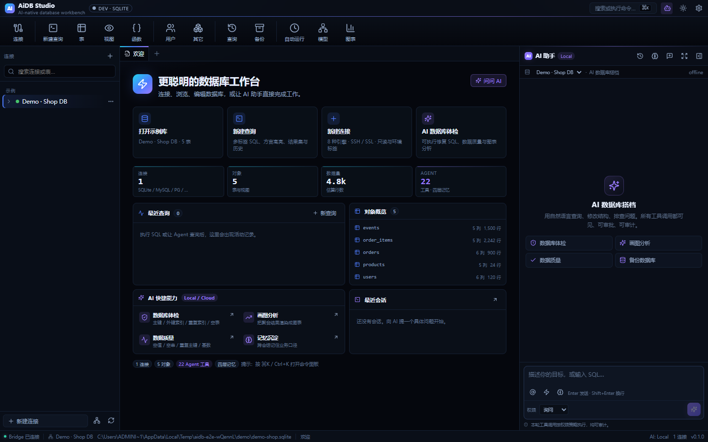
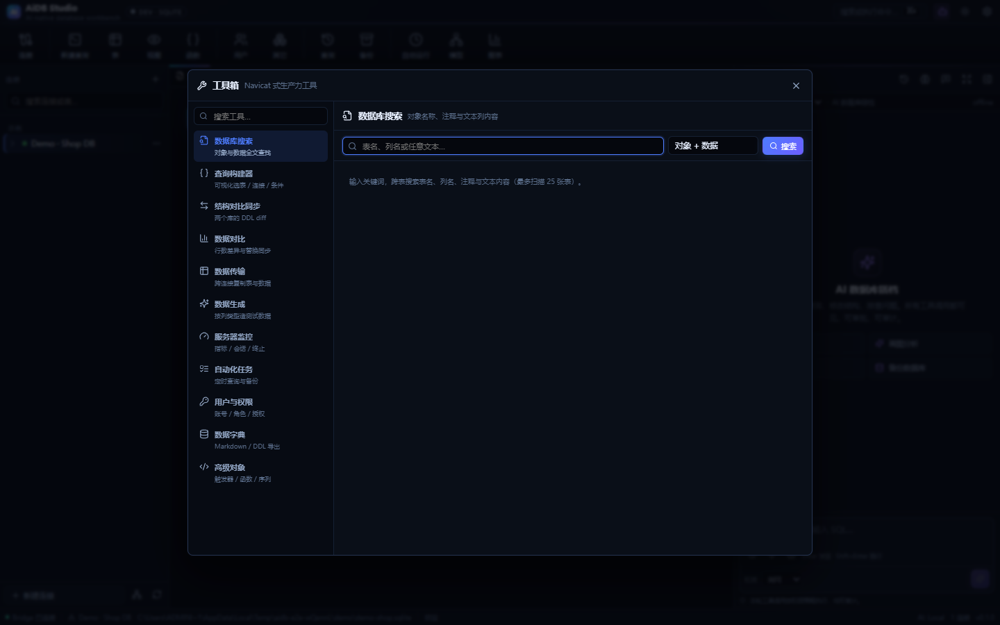

## 核心能力

### Navicat 式主界面
- **顶部功能区**：连接、新建查询、表、视图、函数、用户、其它、查询、备份、自动运行、模型、图表共 12 个大图标入口。
- **对象树**：连接 → 数据库 / Schema → **表 / 视图分组**，并固定提供函数 / 存储过程、查询、备份入口。
- **数据库右键菜单**：关闭、编辑 / 新建 / 删除数据库、新建表、新建查询、命令列、运行 SQL 文件、转储 SQL、逆向到模型、在数据库中查找、刷新。
- **表右键菜单**：打开、设计、新建、重命名、复制（结构 / 结构+数据）、查看 DDL、维护、对象信息、设置权限、导入 / 导出向导、清空、截断、删除、逆向到模型。

### 数据库工作台
- **连接管理**：**8 种引擎** — SQLite / MySQL / MariaDB / PostgreSQL / CockroachDB / SQL Server / Oracle / ClickHouse；SSH 隧道、环境标签（DEV / STG / PROD）、只读模式、AES-256-GCM 加密凭据、测试连接。
- **对象浏览器**：连接 → 库 / Schema → 表 / 视图 → 列 / 索引 / 外键，搜索、右键菜单、懒加载；表和视图分组展示。
- **数据网格**：行号、分页、排序、WHERE 过滤、**可视化筛选构建器**、**排序对话框**、**文本视图**、双击编辑、新增/删除行、**行多选**、**复制 / 粘贴 / 复制行 / 批量删除**、**查找替换**、主键安全定位、记录区间与页码；**CSV 导入向导**（分隔符 / 表头 / 预览 / 列映射），导出 CSV / JSON / SQL / XML。
- **SQL 工作台**：CodeMirror 6、8 种方言高亮、**连接 / 数据库下拉**、Ctrl/⌘+Enter 执行、多结果集、消息面板、查询历史、EXPLAIN、**保存 / 打开 SQL 文件**、**查询创建工具**、**美化 SQL**、**SQL 片段库**、**结果图表**（柱状 / 折线 / 饼图），以及 **AI 解释 / AI 优化** 一键送入 Agent。
- **表设计器**：可视化列定义、增删列、类型变更，**可视化索引设计**，DDL 实时预览与执行。
- **表操作**：新建、设计、重命名、复制（仅结构 / 结构+数据）、查看 DDL、对象信息、清空、截断、删除、维护（分析 / 优化 / 检查 / 修复 / 回收空间）。
- **数据库操作**：按引擎能力新建 / 重命名 / 删除数据库、逻辑转储、数据库内查找、命令列、运行 SQL 文件。
- **关系图**：基于外键的只读 ER 视图，表结构卡片 + 连线，点击进入数据，**导出 SVG**。
- **备份**：逻辑 SQL dump；**从备份 SQL 恢复**；破坏性操作前自动备份（可配置）。
- **审计 / 历史**：所有用户与 Agent 操作、审批结果、耗时、风险等级；支持导出 CSV。
- **Appearance**：深色 / 浅色主题、紧凑 / 舒适密度、中 / 英壳层。

### 工具箱（Navicat 级生产力）
工具箱入口位于左侧导航，11 个模块全部连接同一 Bridge 与权限模型：

| 模块 | 能力 |
|---|---|
| 数据库搜索 | 对象名 / 注释 + 数据文本列全文查找，结果可直接打开 |
| 查询构建器 | 选表、连接、列、WHERE、排序、行数，生成 SQL 送入编辑器 |
| 结构对比同步 | 两连接 DDL diff，生成目标方言语，确认后执行同步 |
| 数据对比 | 行数 + 主键指纹差异，按表替换同步 |
| 数据传输 | 跨连接复制表结构与数据，自动建表，追加 / 清空后写入 |
| 数据生成 | 按列语义、类型与外键造 1–5000 行测试数据，预览后插入 |
| 服务器监控 | 引擎指标、会话列表，10s 刷新，终止会话 |
| 自动化任务 | 定时 SQL / 备份任务，最小 30s 间隔，立即运行、启停、状态 |
| 用户与权限 | 账户 / 角色列表、创建、删除、授权（SQLite 除外） |
| 数据字典 | Markdown / DDL / JSON 导出，含列类型、默认值、注释 |
| 高级对象 | 触发器 / 函数 / 存储过程 / 序列 / 事件及定义查看 |

### 支持的数据库引擎（8 种）

| 引擎 | 协议 / 驱动 | 说明 |
|---|---|---|
| SQLite | `node:sqlite` | 文件型，内置示例库 |
| MySQL | `mysql2` | 主流关系型 |
| MariaDB | `mysql2` | MySQL 协议兼容 |
| PostgreSQL | `pg` | 完整对象关系 |
| CockroachDB | `pg` | 分布式 SQL |
| SQL Server | `mssql` / tedious | 企业关系型 |
| Oracle | `oracledb` thin | 无需 Instant Client |
| ClickHouse | HTTP (`fetch`) | 列式分析，8123 端口 |

> 连接表单会按引擎自动切换默认端口、数据库字段（Oracle 服务名 / SQLite 文件路径）与 SSL / SSH 能力。

### AI Agent（核心差异）
- **Claude Code 式对话**：`❯` 输入、`⏺` 工具卡、参数 / 结果 / SQL 可折叠、Todo 计划、结束统计、思考过程、`@table` 引用、斜杠命令、中断。
- **22 个数据库工具**：结构检查、搜索、SQL、执行计划、样例、列画像、**数据库体检**、**数据质量检查**、**图表生成**、建表、改表、删表、索引、导入、导出、备份、历史、计划、记忆写入 / 检索。
- **SQL Copilot**：编辑器内一键“AI 解释 / AI 优化”，自动把选中 SQL 送入 Agent，输出改写 SQL、精确索引 DDL 与验证查询。
- **审计闭环**：体检/质量发现的每条问题都附带可执行 SQL，可一键打开到编辑器；写操作前自动备份，审批结果全部落审计。
- **四级权限**：只读 / 询问 / 自动 / 全自动；只读连接服务端强制；生产环境破坏性操作强制审批；会话级 / 连接级 Allow 规则。
- **四层记忆**：工作记忆（会话 + 摘要）、情景记忆（会话沉淀）、语义记忆（事实 / 偏好 / 结构）、程序记忆（流程）；混合词法 + 作用域评分检索；去重合并、衰减、可编辑 / 置顶 / 遗忘；桌面与移动端共享。
- **离线可用**：无 API Key 时使用内置 Local Reasoner（规则推理），完整演示查询、建表、索引、备份、导出、记忆。
- **云端模型**：Anthropic Messages API、OpenAI 兼容端点（DeepSeek / Qwen / Ollama / vLLM），SSE 流式与原生 tool calling。
- **安全护栏**：SQL 静态风险分类、自动 LIMIT、只读拦截、审批超时、审计、破坏性操作前备份、路径白名单。

### Bridge 网关 & 多端
- 桌面端内置 Bridge；也可作为独立 Linux 服务部署（Dockerfile 提供）。
- 移动端通过 **6 位配对码** 换取设备令牌，共享会话、记忆与权限模型；移动端默认只读。
- REST + SSE（桌面 / Web）+ WebSocket（移动端）。

## 截图

| | |
|---|---|
| 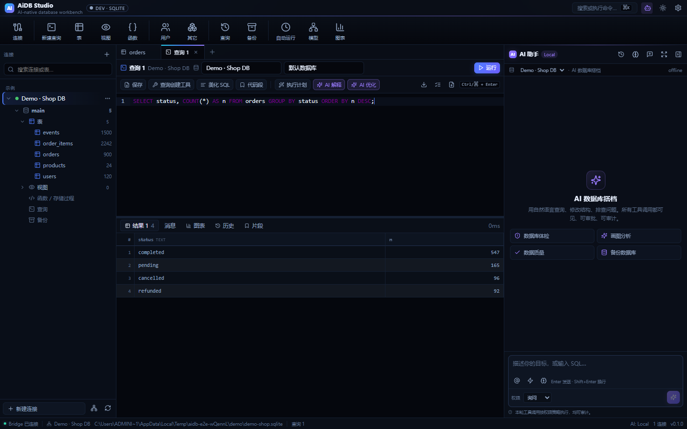 | 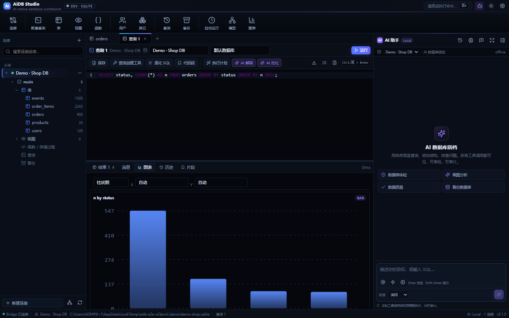 |
| 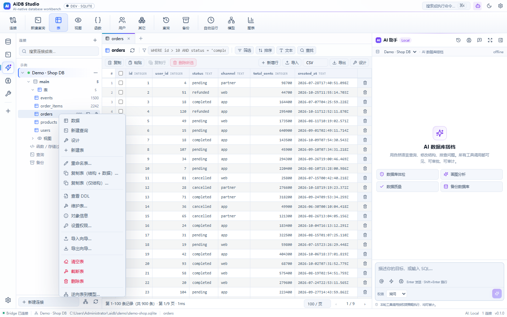 | 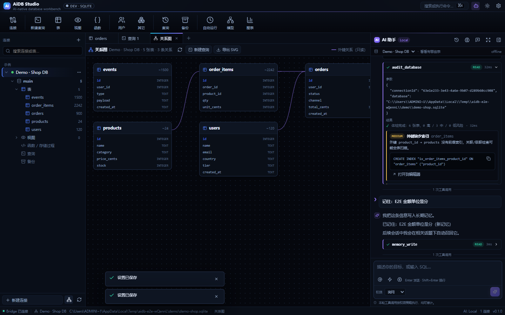 |
| 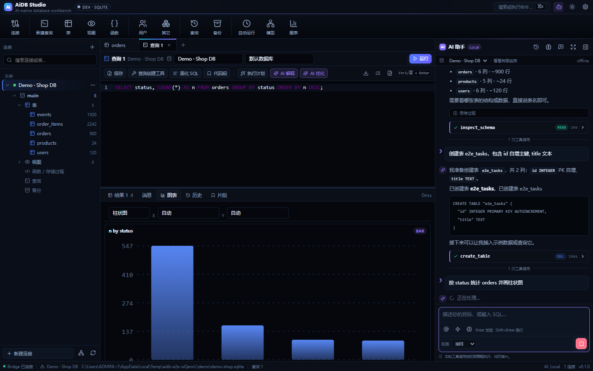 | 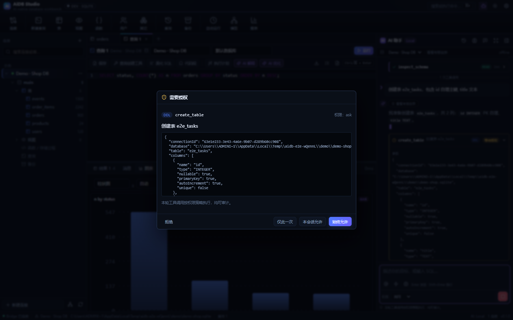 |
| 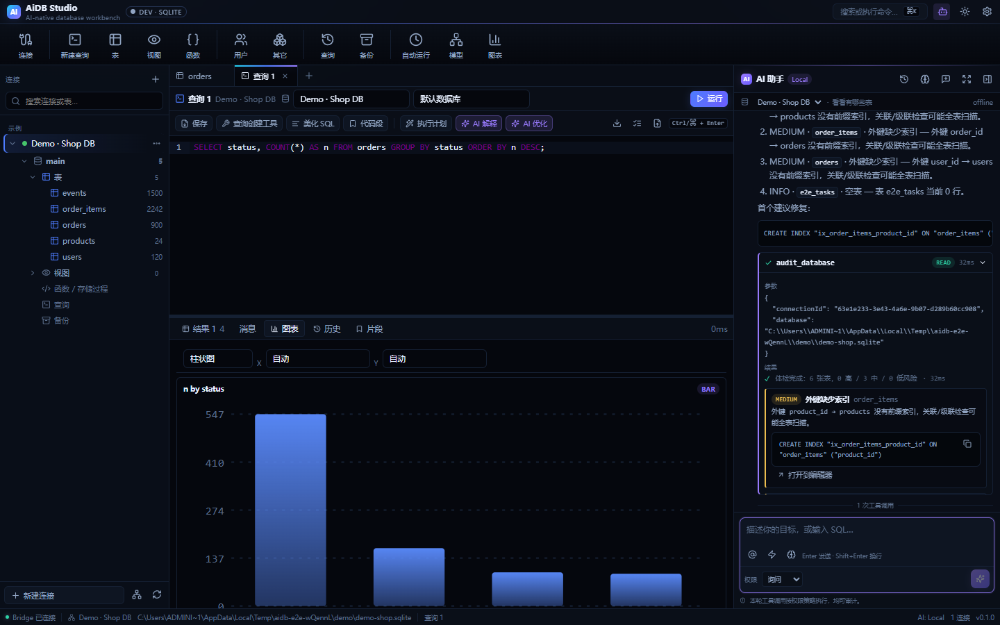 | 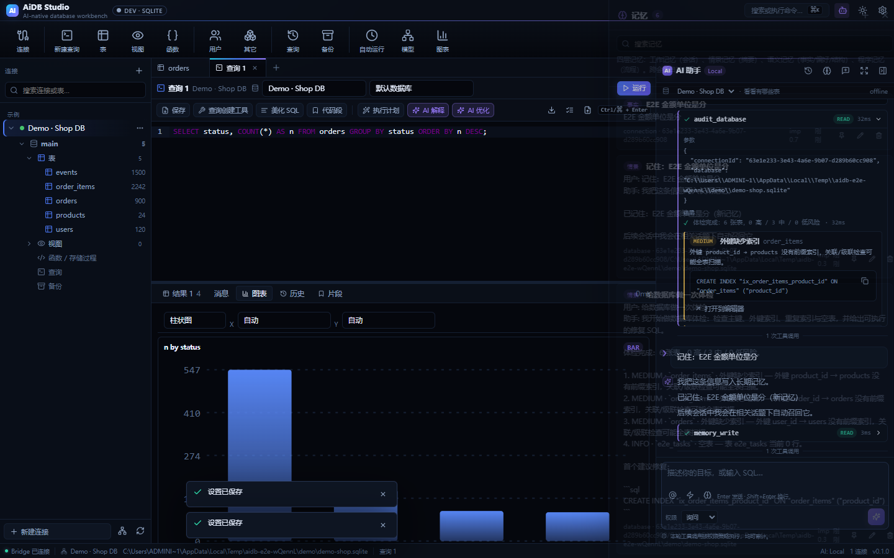 |
| 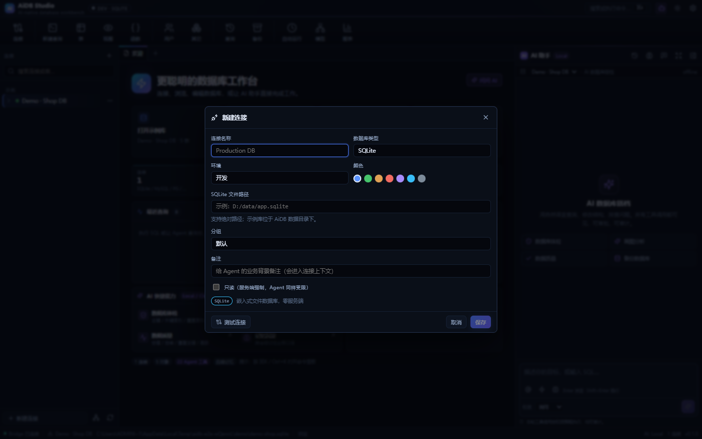 | 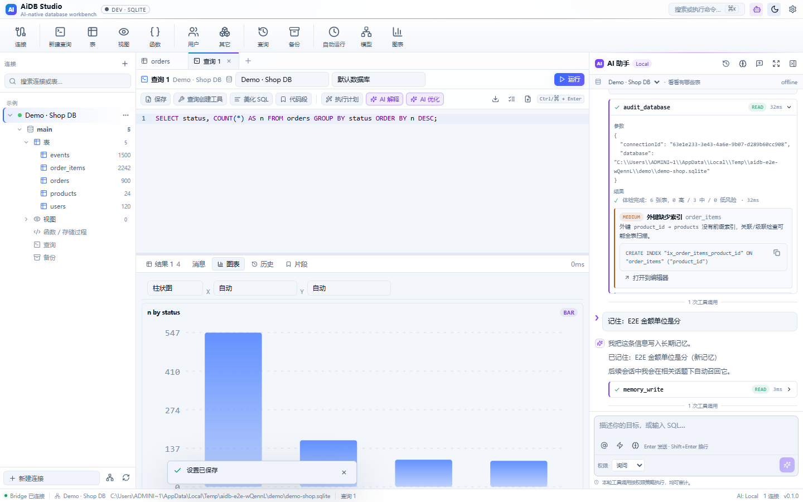 |
|  | 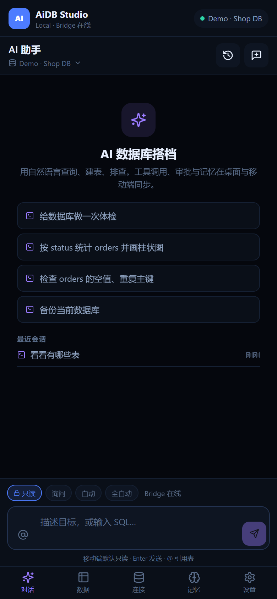 |
| 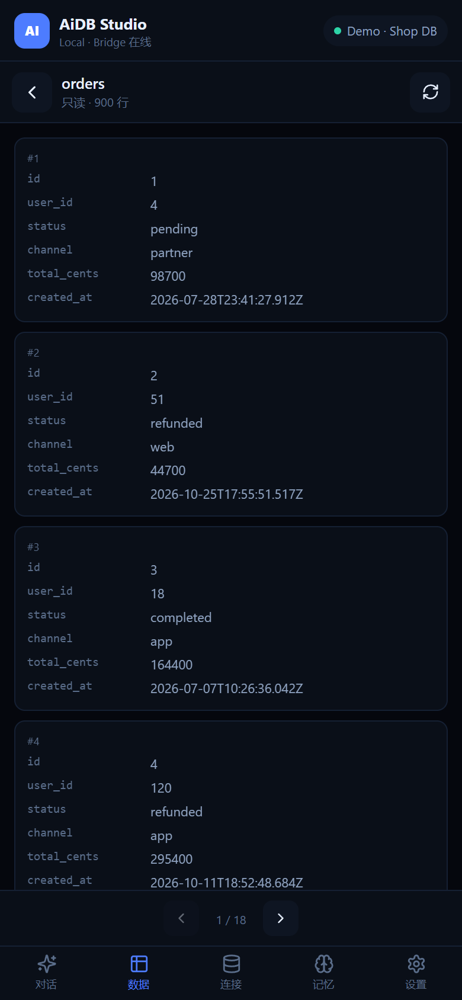 | |

## 平台与验证状态

| 平台 | 实现 | 本地验证 |
|---|---|---|
| Windows | Electron 45 + React | ✅ 打包 `win-unpacked`，启动真实安装产物，内置 Bridge、数据网格、Agent 全部可用 |
| Linux | Electron 45 + React | ✅ 交叉构建 `linux-unpacked`；离线服务 Dockerfile 通过 `docker build --check` |
| macOS | Electron 45 + React | ⚠️ 配置完整；electron-builder 明确要求在 macOS 宿主产出 `.app` / dmg（Windows 交叉构建被拒绝） |
| Android | Expo SDK 52 / RN 0.76 | ✅ TypeScript 通过、Expo Web 冒烟、`expo prebuild` 生成原生工程、Gradle `assembleDebug`（见报告） |
| iOS | Expo SDK 52 / RN 0.76 | ✅ iOS 原生工程已生成（Linux 容器）、类型与 Expo Web 通过；⚠️ IPA 需 macOS / EAS 编译 |

> 自动化验证：文档契约 **136/136**、Core **40/40**、Bridge **10/10**、E2E **37/37**；桌面产物已启动真实 exe 复核 Ribbon、连接与数据网格。

> 详细的命令输出、缺陷修复与未覆盖项见 [验证报告](docs/07-verification-report.md)。

## 快速开始

要求：**Node.js ≥ 22.5**（Bridge 使用内置 `node:sqlite`），npm 10+。

```bash
npm install
npm run dev            # Bridge :8787 + Web UI :5180
# 打开 http://localhost:5180
```

首次启动会自动创建并填充示例电商库（users / products / orders / order_items / events，最近 120 天）。

桌面应用（Electron 45）：

```bash
npm run dev:desktop    # Bridge + Vite + Electron
npm run build:desktop  # 打包安装包（当前平台）
```

移动端（Expo）：

```bash
npm --workspace apps/mobile run start       # Expo Go / 模拟器
npm --workspace apps/mobile run web         # 浏览器预览
npm --workspace apps/mobile run android     # 本地 Android 工程
```

Android 原生构建（需 JDK 17+ 与 Android SDK 35）：

```bash
cd apps/mobile
npx expo prebuild --platform android   # 已提交 android/ 工程；必要时可重新生成
# 设置 ANDROID_HOME，或在 android/local.properties 写 sdk.dir
cd android && ./gradlew assembleDebug
# 产物：android/app/build/outputs/apk/debug/app-debug.apk
```

> 已在本机使用 Java 21 + SDK 35 成功构建 debug APK（119 MB）。原生工程固定 Kotlin 1.9.24 以匹配 Expo Compose 编译器。

iOS：`ios/` 原生工程已生成。在 macOS 上执行 `cd ios && pod install` 后用 Xcode 打开 `AiDBStudio.xcworkspace`，或使用 `eas build -p ios`。

配对步骤：

1. 桌面端打开 **设置 → Bridge → 为移动端配对**，获得 6 位码。
2. 移动端输入 Bridge 地址（如 `http://192.168.1.10:8787`）与配对码。
3. 连接成功后，移动端与桌面共享连接、会话与记忆。

## 命令

| 命令 | 说明 |
|---|---|
| `npm run dev` | Bridge（tsx 热重载）+ Vite UI |
| `npm run seed` | 创建 / 校验示例 SQLite 库 |
| `npm run typecheck` | 四个 workspace 全量类型检查 |
| `npm test` | Core 单测 + Bridge 集成测试 |
| `npm run build` | Core / Bridge bundle / 桌面 UI / 移动 Web |
| `npm run build:desktop` | Electron 安装包（Windows NSIS / macOS dmg / Linux AppImage） |
| `npm run build:mobile` | Expo Web 导出 |
| `npm run e2e` | 无头浏览器：桌面 Web + 移动 Web + Electron Shell |
| `npm run verify` | 文档契约 → 类型 → 测试 → 构建 → E2E |
| `npm run verify:docs` | 设计文档契约（136 项） |

## 目录

```
docs/                   设计文档 + 验证报告 + 截图
packages/core/          平台无关内核：SQL、Agent、工具、权限、记忆、Provider
apps/gateway/           Bridge：驱动、元数据库、REST/SSE/WS、Agent 宿主、Dockerfile
apps/desktop/           Electron 45 + React 渲染层（也可纯浏览器运行）
apps/mobile/            Expo React Native（Android / iOS / Web）
scripts/                文档契约、种子、E2E、Electron 启动器
```

## 模型配置

应用内 **设置 → Agent**：

| Provider | 说明 |
|---|---|
| Local（离线） | 无 Key；覆盖结构、查询、建表、备份、导出、记忆等基础指令 |
| Anthropic | `/v1/messages` + tools + SSE |
| OpenAI Compatible | `/v1/chat/completions`，兼容 Ollama / DeepSeek / Qwen / vLLM |

API Key 加密存储；也可用环境变量 `AIDB_API_KEY`（Bridge）覆盖。无 Key 时可随时回退 Local。

## 安全模型

- Bridge 默认仅监听 `127.0.0.1`；移动端配对生成可吊销的设备令牌；远程部署建议 TLS。
- 连接密码 / SSH 私钥 / 模型 Key 使用 AES-256-GCM 加密；独立 Bridge 由 `AIDB_SECRET` 派生密钥。
- 只读连接在服务端强制；SQL 静态分类；默认拒绝多语句；自动 LIMIT；生产环境破坏性操作强制审批。
- 所有操作与审批写入审计日志；Agent 与手工操作使用同一套执行器与策略。

## 已知限制（v0.3）

- SQLite 完成真实集成；其余 7 种引擎的驱动与方言已实现并通过单测/编译，但本机无实例，未做服务器级集成验证（Oracle 为 thin 模式）。
- SSH 隧道代码完整，未连接真实堡垒机验证。
- 云端 Provider 的 SSE / tool-call 解析使用模拟流测试，未使用真实 API Key 发起调用。
- 自动记忆在离线模式下为保守的显式规则抽取 + 会话摘要；云端模型的额外抽取调用未启用。
- 结构同步覆盖建表、删表、加列 / 改列与索引；不做对象重命名推断，跨对象依赖按表 / 索引分层执行，复杂存储过程依赖未排序。
- 数据对比使用行数 + 主键指纹，不做逐行内容校验 / 双向合并；同步方式为整表替换。
- 自动化任务仅在 Bridge 运行时生效，不支持 cron 表达式与跨节点调度；最小间隔 30s。
- 服务器监控与用户管理依赖账号权限，返回字段随引擎能力裁剪；SQLite 不支持用户管理。
- SQL Server 暂不支持自动 EXPLAIN；ClickHouse 不支持独立二级索引（工具会返回明确提示）。
- 图表支持单序列柱状 / 折线 / 饼图，多维与堆叠图未实现。
- 导入支持 CSV（含分隔符 / 表头 / 列映射预览）；Excel 与 XML 仅导出，不导入。
- 高级对象为只读查看，暂不支持可视化编辑触发器 / 存储过程。
- 数据编辑当前即时提交；尚未提供 Navicat 式“开始事务 / 提交 / 回滚”的跨请求事务模式。
- 数据库新建 / 删除 / 重命名为引擎相关能力：MySQL/MariaDB 不支持重命名数据库；SQLite 与 Oracle 不支持新建 / 删除数据库。
- 表菜单中的打印、创建打开表快捷方式、管理组尚未实现；复制表拆分为“仅结构 / 结构+数据”两项。
- “导入向导”当前打开表数据页后选择 CSV 文件，尚未做成独立的全屏向导；导出支持格式选择与向导式参数。
- macOS 安装包、iOS IPA 需对应宿主系统 / EAS 构建；Android APK 构建结果见验证报告。
- 移动端默认只读，写操作与工具箱未开放。
- 明确不做（非目标）：报表设计器、云同步 / 团队协作、ER 模型反向编辑。

## 设计文档

- [产品总览](docs/00-product-overview.md)
- [技术架构](docs/01-tech-architecture.md)
- [功能规格](docs/02-feature-spec.md)
- [UI/UX](docs/03-ui-ux-design.md)
- [AI Agent](docs/04-ai-agent-design.md)
- [数据模型与协议](docs/05-data-and-api.md)
- [交付与验证](docs/06-delivery-and-verification.md)
- [验证报告](docs/07-verification-report.md)

## License

MIT
