<p align="center">
  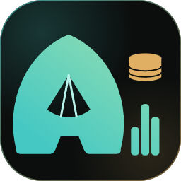
</p>

<h1 align="center">AiDB Studio</h1>

<p align="center"><strong>数据库工作台，也是数据库 Agent。</strong></p>

<p align="center">
  <a href="./README.md">English</a> ·
  <strong>简体中文</strong> ·
  <a href="./README.zh-TW.md">繁體中文</a> ·
  <a href="./README.ja.md">日本語</a> ·
  <a href="./README.ko.md">한국어</a> ·
  <a href="./README.de.md">Deutsch</a> ·
  <a href="./README.fr.md">Français</a> ·
  <a href="./README.es.md">Español</a> ·
  <a href="./README.pt-BR.md">Português (BR)</a> ·
  <a href="./README.it.md">Italiano</a> ·
  <a href="./README.ru.md">Русский</a> ·
  <a href="./README.ar.md">العربية</a> ·
  <a href="./README.hi.md">हिन्दी</a> ·
  <a href="./README.id.md">Bahasa Indonesia</a> ·
  <a href="./README.vi.md">Tiếng Việt</a> ·
  <a href="./README.th.md">ไทย</a> ·
  <a href="./README.tr.md">Türkçe</a> ·
  <a href="./README.nl.md">Nederlands</a> ·
  <a href="./README.pl.md">Polski</a> ·
  <a href="./README.uk.md">Українська</a>
</p>

<p align="center">
  
  
  
  
  
</p>

<p align="center">
  
  
  
  
  <a href="https://github.com/keiskeies/ai-db/releases/tag/v0.0.5"></a>
  <a href="https://github.com/keiskeies/ai-db"></a>
</p>

AiDB 不是把聊天框嵌进数据库客户端。它以 Agent 为第一入口，把连接、结构、SQL、数据、仪表板、报告与审计统一成一套可执行的上下文。你用一句业务目标发起任务，Agent 用与人类相同的工具去查证、执行、验证和交付。

从 41 种数据库引擎到 14 个生产力模块，从 53 个工具到 6 个命令工作流，所有能力都围绕一个原则构建：**Agent 能做的，必须可见、可控、可审计；Agent 不能做的，绝不假装能做。**

桌面端使用 Electron + React，可同时以浏览器形态运行；移动端使用 Expo / React Native，通过 Bridge 与桌面共享连接、会话、记忆和设置。支持 Windows、macOS、Linux、Android、iOS 与 Web。

<p align="center">
  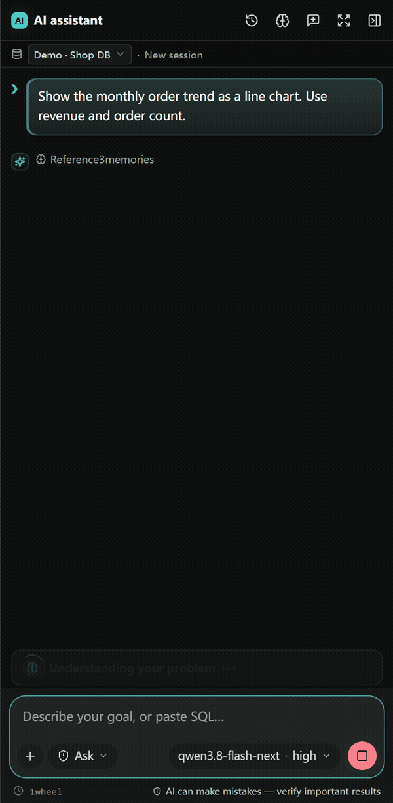
</p>

## Agent 实战

下面的截图来自真实会话，不是示意图：Agent 制定计划，对 Demo 数据库调用真实工具，渲染实时图表，并在同一个工作台里写出可逐项核对的结论。

| 计划与工具调用 | 带可核对数字的回答 |
|---|---|
| 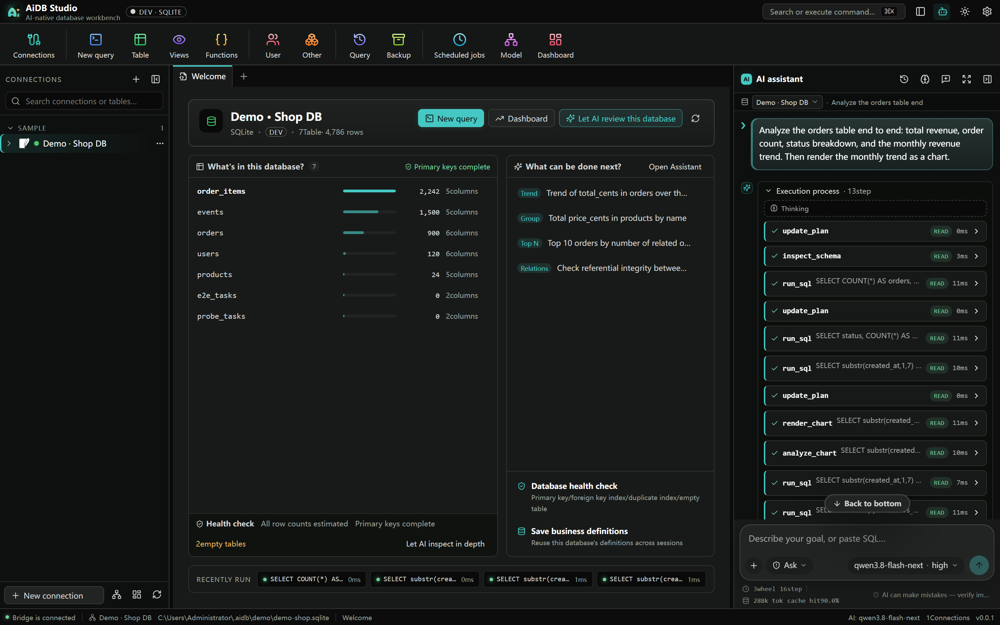 | 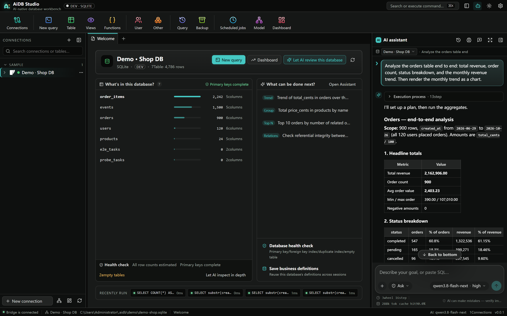 |

| Agent 渲染的实时图表 | 完整 Agent 面板 |
|---|---|
| 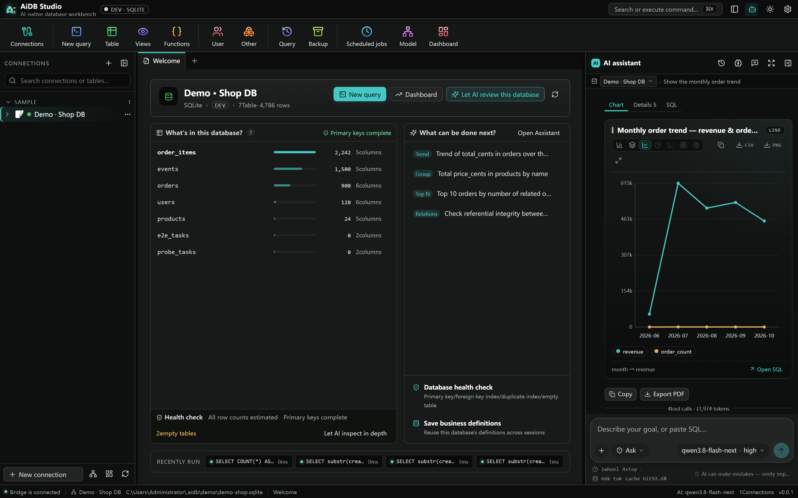 | 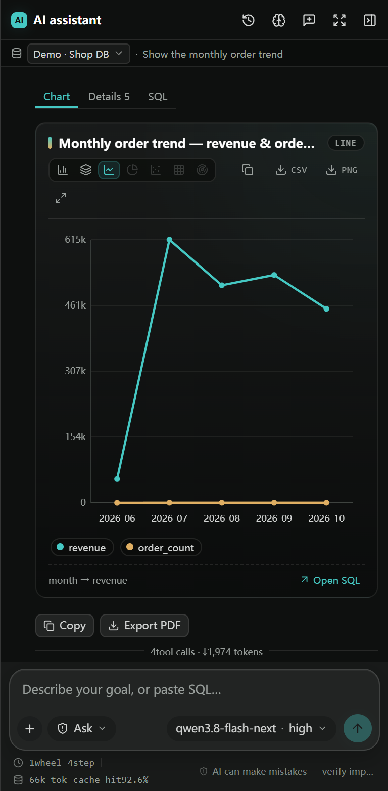 |

- **审批是硬门槛**：结构变更会停下等待明确决定，界面上给出工具、参数、风险与作用域。
- **预测必须交代方法**：模型、拟合度与区间都要讲清楚，而不是往图里丢一条线。
- **每一步都可审计**：工具名、参数、风险等级、耗时、token 用量与缓存命中率都留在回答旁边。

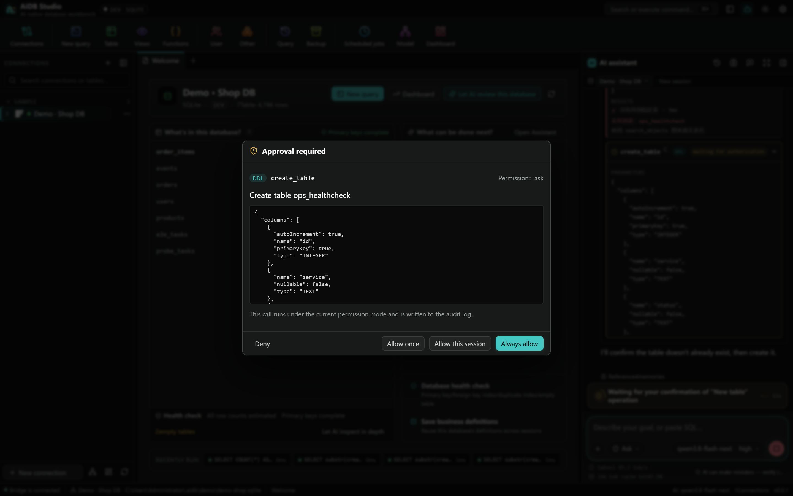

## Agent 优先

把 AI 放进数据库工具，最难的不是接一个模型，而是让它拥有和资深工程师相同的工作条件：看见真实结构，拿到真实数据，执行真实 SQL，并对结果负责。

AiDB 的选择是把 Agent 放在任务主路径上，而不是侧边栏里。在 AiDB 中，Agent 不是功能列表的尾声，而是所有功能的组织方式。

- **同一个执行面**：Agent 看到的连接、结构、数据与执行器，和用户手工操作完全一致；不存在另一套更宽松的入口。
- **同一个风险边界**：只读、审批、备份、审计不是提示词里的建议，而是执行器的硬约束。
- **同一份上下文**：表结构、业务术语、Agent 上下文、长期记忆与 `AI_DB.md` 交接文档共同决定它如何理解你的库。
- **可交付的结果**：回答不是终点；图表、报告、修复计划、对账差异都可以保存、刷新、导出。
- **可积累的经验**：会话记忆、长期记忆与手工维护的业务语义，让下一次任务不再从零开始。

| 层 | Agent 在此获得什么 |
|---|---|
| 意图 | 自然语言、`@table`、图片、斜杠命令与命令工作流 |
| 执行 | 53 个工具，覆盖查询、写入、DDL、事务、图表、体检、对比、迁移与数据流 |
| 上下文 | 真实 schema、业务别名、术语、示例 SQL、长期记忆、大库候选表检索 |
| 控制 | 只读 / 询问 / 自动 / 全自动，审批、备份、审计与执行轨迹 |
| 交付 | 图表、PDF、仪表板卡片、报告、Excel / PPTX、可重跑产物 |
| 扩展 | Skills、MCP、网络搜索、机器人通知与外部系统 |

## 能力概览

- **53 个 Agent 工具**：查询、结构变更、数据写入、图表、体检、对比、迁移、数据流、Skill、MCP。
- **6 个命令工作流**：`/report`、`/compare`、`/diff`、`/recon`、`/fix`、`/ask`，外加 `/init` 数据库交接文档。
- **41 种数据库引擎**：关系型、文档、键值、图、向量、搜索、宽列、时序。
- **14 个工具箱模块**：报告、数据流处理、搜索、查询构建、结构同步、数据对比、传输、生成、监控、自动化、用户、字典、高级对象、Agent 上下文。
- **7 种图表**：柱状、堆叠、折线、饼、散点、热力、雷达；折线支持预测区间与双轴。
- **4 档权限**：只读、询问、自动、全自动；只读连接在服务端强制执行。

## 目录

- [Agent 实战](#agent-实战)
- [Agent 优先](#agent-优先)
- [能力概览](#能力概览)
- [快速开始](#快速开始)
- [AI Agent](#ai-agent)
- [报告与命令工作流](#报告与命令工作流)
- [工作台](#工作台)
- [连接与多引擎](#连接与多引擎)
- [对象树与数据库操作](#对象树与数据库操作)
- [数据网格](#数据网格)
- [SQL 工作台](#sql-工作台)
- [表设计器与关系图](#表设计器与关系图)
- [仪表板](#仪表板)
- [工具箱](#工具箱)
- [移动端](#移动端)
- [设置](#设置)
- [集成：通知、Skill、MCP、网络搜索](#集成通知skillmcp网络搜索)
- [架构](#架构)
- [命令](#命令)
- [安全模型](#安全模型)
- [设计边界](#设计边界)
- [设计文档](#设计文档)

## 快速开始

要求 **Node.js ≥ 22.13**（Bridge 使用内置 `node:sqlite`，22.13+/23.4+ 才不需要实验 flag）和 npm 10+。

```bash
npm install
npm run dev
# Web UI:  http://localhost:5180
# Bridge:  http://127.0.0.1:8787
```

首次启动会在 `~/.aidb/demo` 创建并填充示例电商库（users / products / orders / order_items / events）；打开左侧 **Demo · Shop DB** 即可直接试 SQL、图表和 AI 提问。

桌面应用：

```bash
npm run dev:desktop    # Bridge + Vite + Electron
npm run build:desktop  # 打包当前平台安装包
```

移动端：

```bash
npm --workspace apps/mobile run start    # Expo Go / 模拟器
npm --workspace apps/mobile run web      # 浏览器预览
npm --workspace apps/mobile run android  # 本地 Android 工程
```

移动端配对：桌面端 **设置 → Bridge → 为移动端配对** 生成二维码与 6 位配对码；手机扫码、输入配对码，或通过 `aidb://pair` 深链 / 同网段发现连接。配对成功后，两端共享连接、会话、记忆和模型设置。

> Bridge 默认只监听 `127.0.0.1`。公网或反向代理部署时设置 `AIDB_PUBLIC_URL=https://db.example.com`，并参考 [安全模型](#安全模型)。

## AI Agent

Agent 的能力不是一句“支持自然语言”。它由六件事共同决定：能看见什么、能做什么、被什么约束、记得什么、如何交付、如何扩展。一次任务在 AiDB 内走完理解、计划、执行、验证、交付、沉淀六个阶段，每一步都留下界面证据。

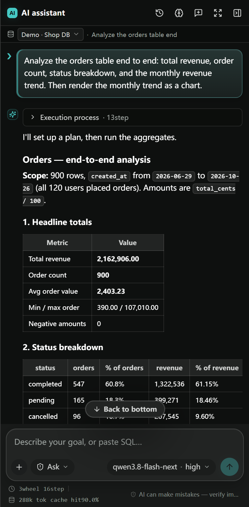

### 它能把什么做完

- **问数**：从业务问题出发，自己确认口径、选择表、写 SQL、校验结果，给出结论、图表与基线，而不是丢回一段 SQL。
- **体检与修复**：检查主键、外键索引、重复索引、空表与数据质量，生成分级修复计划；执行前备份，执行后验证。
- **结构变更**：建表、改列、索引、集合与文档写入，结构变化会同步刷新对象树与数据页。
- **对比与迁移**：跨库结构 diff、行级对账、跨连接数据传输，输出可确认、可复核的差异清单。
- **交付**：把分析变成可保存的图表、仪表板卡片、报告、Excel / PPTX 或 PDF，而不是留在聊天记录里。

### 工作方式

- **Claude Code 式对话**：`❯` 用户消息、`⏺` 工具卡、可折叠参数 / 结果 / SQL、Todo 计划、执行统计、可折叠思考过程、结束统计。
- **活动条**：实时显示“正在理解问题 / 拆解任务 / 执行工具 / 等待确认 / 整理结果”，不是只转圈。
- **计划**：`update_plan` 驱动计划清单，✓ / ◐ / ○ 状态实时更新；可展开查看。
- **工具轨迹**：每次工具调用的参数、结果、耗时、SQL、错误都可见；结果可打开到编辑器。
- **智能滚动**：只有停在底部时才跟随新输出；用户向上翻阅时出现“回到最新输出”按钮，不强行拉回。
- **追问建议**：每轮结束后基于本轮涉及的表给出可点击的下一步问题，本地生成，不额外消耗 token。
- **模型与档位**：输入框底部胶囊切换模型和推理档位；档位来自当前模型的 Model Profile。
- **权限胶囊**：只读 / 询问 / 自动 / 全自动随时切换，当前档位在界面上始终可见。
- **@ 引用**：`@table` 把表结构注入上下文；支持多表、多库。
- **图片附件**：最多 4 张图片随消息发送；支持相册选择与移除。
- **会话**：按连接 + 库隔离、自动接上该库最近会话、搜索、改名、删除、归档 / 恢复。
- **导出**：回答可导出 PDF，打印样式保留图表背景色；也可复制。
- **中断**：可停止当前回合，已输出内容保留，当前工具执行完成后标记 aborted。

### 工具集：53 个可执行动作

| 分组 | 工具 |
|---|---|
| 连接与结构 | `list_connections`、`inspect_schema`、`search_objects`、`get_query_history` |
| SQL 执行与事务 | `run_sql`、`explain_sql`、`sample_rows`、`profile_column`、`begin_transaction`、`commit_transaction`、`rollback_transaction` |
| 多方言语句与检索 | `run_mql`、`run_redis`、`run_cypher`、`run_cql`、`run_aql`、`search_index`、`vector_search` |
| 集合与文档 | `create_collection`、`delete_collection`、`upsert_document`、`import_documents`、`delete_documents`、`write_line_protocol` |
| 表结构与数据变更 | `create_table`、`alter_table`、`drop_object`、`manage_index`、`import_csv`、`export_result`、`generate_data` |
| 分析、图表与体检 | `audit_database`、`check_data_quality`、`render_chart`、`analyze_chart`、`forecast_chart` |
| 对比与迁移 | `schema_diff`、`recon_data`、`transfer_data` |
| 数据流处理 | `manage_pipeline` |
| 运维 | `backup_database` |
| 计划与记忆 | `update_plan`、`memory_write`、`memory_search` |
| Skill | `skill_list`、`skill_read`、`skill_write`、`skill_run`、`skill_list_files`、`skill_worker_run` |
| MCP | `mcp_list_servers`、`mcp_list_tools`、`mcp_call` |

工具入参使用 JSON Schema（`additionalProperties: false`），风险分级为 `read < write < ddl < destructive`。命令私有工具（如 `compose_report`、`submit_fix_plan`）只在该命令内可用，不计入 53 个全局工具。

### 能力目录：让模型知道边界

除了工具，系统提示还会注入一份 **能力目录**，来源是 `packages/core/src/capabilities/*.json` 的 14 份契约。契约声明每个功能是什么、需要哪些字段、有哪些状态、是否有对应 Agent 工具：

- 有工具的功能：写明工具名、参数和状态，模型直接调用；
- 无工具的功能：压缩成“引导用户到工具箱 → X”，明确禁止编造参数或声称已完成；
- 同一份契约同时驱动 Agent 提示、REST 参数校验和 UI 表单渲染。

### 权限：能力必须有闸门

| 模式 | 行为 |
|---|---|
| 只读 | 所有写操作拒绝；只读连接服务端强制 |
| 询问 | 读直接执行；写、DDL 需审批；破坏性始终审批 |
| 自动 | 读、写、DDL 自动放行；破坏性仍需审批 |
| 全自动 | 全部放行；生产环境的破坏性操作仍需确认 |

审批支持“允许一次 / 本会话允许 / 始终允许”。生产环境的破坏性操作强制走审批；MCP 写工具默认审批，且签名包含路径 / URL，不会因批准一个文件而放行另一个路径。

### 上下文与记忆

- **会话记忆**：会话持久化，超长时自动压缩为摘要；归档会话可随时恢复。
- **长期记忆**：事实、偏好、结构、情景、程序、术语、SQL 示例七种类型；混合词法 + 作用域评分检索；去重、衰减、置顶、编辑、遗忘。
- **Agent 上下文**：按库维护表 / 列的启用状态、业务别名、描述、取值释义、手工关联、术语词典和示例 SQL；这些内容会注入提示，直接提升问数准确率。
- **禁用表护栏**：被禁用的表不仅在提示中隐藏，`run_sql`、`sample_rows`、`inspect_schema`、`profile_column`、`manage_index` 等对象级工具会在执行层拦截；元数据枚举也会被拒绝。
- **大 schema 检索**：超过 150 张表或 2,500 列时自动启用候选表检索，按问题挑表并补一跳关联表，避免把整库塞进提示。
- **SQL 自动修复**：执行失败时把错误、真实列名、编辑距离建议回灌给模型，最多自动修复 2 次，修复后的 SQL 仍走完整权限与审批。
- **`/init` 交接文档**：扫描当前库生成 `AI_DB.md`，后续对话自动加载；自动段落每次 `/init` 刷新，人工补充段落保留。

### 模型与推理

模型配置是 **服务商中心** 的，而不是单个模型：

- 一个服务商配置一次 API 地址和密钥，下面可以挂多个模型；
- 每个模型可配置上下文窗口、最大输出、图片输入、推理档位；
- 在 AI 输入框底部切换当前模型与档位，不离开工作区；
- 支持 **Local（离线）**、**Anthropic Messages API**、**OpenAI 兼容端点**（DeepSeek / Qwen / Ollama / vLLM 等）；
- 密钥加密存储；无 Key 时使用内置 Local Reasoner，仍可完成查询、建表、索引、备份、导出、记忆等演示链路。

### 执行护栏

- Bridge 默认只监听 `127.0.0.1`；移动端配对生成可吊销的设备令牌。
- SQL 静态风险分类、自动 LIMIT、多语句默认关闭、只读拦截。
- 破坏性操作前自动备份（可配置）；所有操作与审批写入审计日志。
- Agent 与手工操作共用同一套执行器与策略，不存在绕过入口。
- Skill 运行在声明式权限沙箱；MCP 外部进程需要显式配置；文件系统 / Git / Web 内置 Server 有目录白名单、域名限制和大小上限。

## 报告与命令工作流

Agent 的主路径不止自由对话。AiDB 把高频业务动作收敛为命令：命令定义目标与交付物，Agent 负责在真实库里取证、执行、组织结论。参数不靠表单堆叠，而由语义、上下文和已有 schema 共同推断；桌面端在对话内直接完成，移动端提供等价的命令工作流。

命令不是菜单，而是一份任务契约：它规定风险上限、可用工具、执行方式和最终产物。Agent 的每一次运行都留下步骤、证据和可重跑的结果。

| 命令 | 作用 | 产出 |
|---|---|---|
| `/report` | 按主题、时间范围、阅读对象生成结论先行的业务报告；数字带同口径基线 | 可保存、可刷新、可导出 Excel / PPT 的报告 |
| `/compare` | 两个时间段、分组、查询或数据源的同口径对比 | 对比结论、指标与图表 |
| `/diff` | 两个库的结构差异与目标方言 DDL | 结构差异清单，可确认后同步 |
| `/recon` | 两个源的行级对账，支持 SQL 表与 Redis 键空间 | 数量 / 键级 / 字段级差异，可执行修复 |
| `/fix` | 数据库体检、修复计划与安全执行 | 体检摘要、风险分级、修复 SQL、备份与验证 |
| `/ask` | 不启动命令，直接与 Agent 对话 | 自由问答 |
| `/init` | 扫描当前库生成 `AI_DB.md` 交接文档 | 引擎与规模、业务地图、核心表手册、Join 路径、指标口径、性能与坑、全量清单 |

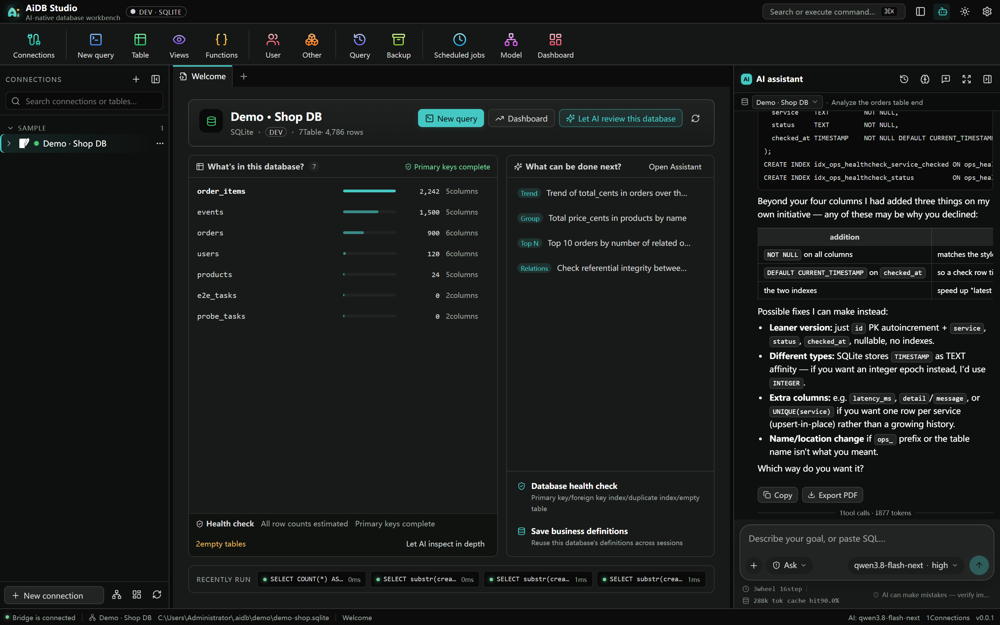

报告与产物会被持久化：

- **报告**：摘要、2–5 个章节、每节结论、指标基线、图表、表格、行动建议；可保存、重跑刷新。
- **产物**：报告、对比、结构差异、对账、体检都有 `artifact + run` 历史；可查看每次运行状态与结果。
- **导出**：报告支持 XLSX / PPTX；安装 PPT Master Skill 后可生成原生 AI PPTX。
- **定时运行**：产物可绑定固定间隔自动重跑，并把摘要推送到通知渠道。
- **审计闭环**：体检 / 质量检查发现的每条问题都带可执行 SQL，可打开到编辑器；修复走备份、dry-run、审批、验证链。

## 工作台

工作台不是 Agent 的附件，而是它赖以判断的现实。连接、对象树、数据、SQL、设计器、仪表板与报告，构成 Agent 可观察、可操作、可复核的执行面；用户在同一个界面里发起任务、检查过程、接管结果。

### 欢迎页：当前库的家

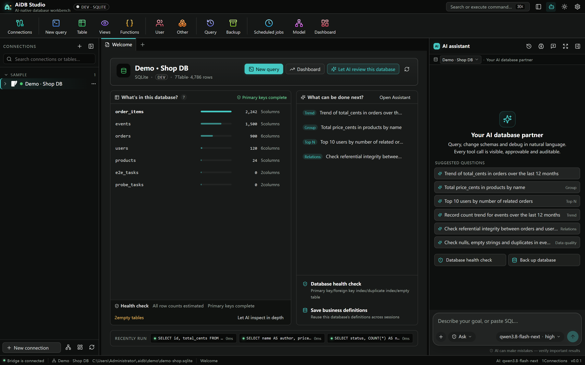

打开应用先看到的是 **当前连接 + 当前库** 的工作台，而不是一张全局仪表盘：

- **当前库头部**：连接名、库名、引擎、环境标签、只读标记、表数 / 视图数 / 行数估算；多库连接可直接切换当前库。
- **这个库里有什么**：表清单按行数排序，显示列数、行数、无主键标记；视图单独标识。
- **体检摘要**：主键齐全 / 无主键数量、空表数量、行数估算覆盖情况，直接摆在表清单下方。
- **接下来能做什么**：根据当前库的表结构生成可点击的 AI 建议（趋势、分组统计、Top N、关联完整性等），点击即进入 Agent。
- **AI 快捷入口**：数据库体检、沉淀业务口径、新建查询、打开仪表板；空库时提供“让 AI 建表”。
- **最近跑过**：按当前库过滤的最近查询，点击回填到 SQL 编辑器。
- **作用域分离**：首页与 Agent 各自瞄准自己的库；两端不一致时会明确提示，可一键对齐。

### 主界面

主界面是一套 Navicat 式的高密度工作区：

- **Ribbon 功能区**：连接、新建查询、表、视图、函数、用户、其它、查询、备份、自动运行、模型、仪表板，共 12 个入口。
- **多页签工作区**：数据、查询、设计器、关系图、仪表板各自成页；右键页签可关闭、关闭其它、关闭全部。
- **命令面板**：`⌘/Ctrl + K` 打开，搜索或执行命令、打开连接、运行备份、切换主题。
- **可拖拽布局**：侧栏和 AI 面板都能拖宽、折叠；AI 面板可展开到 58% 宽度。
- **状态栏**：Bridge 连接状态、当前连接与库、当前页签、当前模型、连接数量。
- **主题与语言**：深色 / 浅色 / 跟随系统，中文 / English 即时切换。
- **自动刷新**：Bridge 推送 `schema_changed` 事件，对象树、数据页、设计器会在结构变化后自动失效并刷新；设计器遇到并发结构变更会提示重新加载或保留本地编辑。

常用快捷键：

| 快捷键 | 动作 |
|---|---|
| `⌘/Ctrl + K` | 命令面板 |
| `⌘/Ctrl + T` | 新建查询 |
| `⌘/Ctrl + B` | 显示 / 隐藏连接栏 |
| `⌘/Ctrl + Shift + A` | 显示 / 隐藏 AI 助手 |
| `⌘/Ctrl + Shift + L` | 聚焦 AI 输入框 |
| `⌘/Ctrl + W` | 关闭当前页签 |
| `⌘/Ctrl + ,` | 打开设置 |
| `F5` | 刷新当前连接结构 |
| `⌘/Ctrl + Enter` | 在查询页执行当前语句 |

## 连接与多引擎

41 种引擎不是一张支持列表，而是 Agent 可以进入的 41 个现场。连接定义、协议能力、只读与 SSH 边界在用户和 Agent 之间完全共享；Agent 不会拥有另一套更宽松的入口。

连接表单会根据引擎自动切换默认端口、数据库字段、SSL / SSH 能力和测试连接方式。

- **连接属性**：名称、颜色、环境标签（DEV / STG / PROD）、分组、备注、只读、SSL、SSH 隧道（密码或私钥）。
- **凭据安全**：连接密码、SSH 私钥、模型 Key、通知 Webhook、MCP 环境变量均使用 AES-256-GCM 加密；列表接口只返回脱敏信息。
- **测试连接**：保存前先验证驱动、网络和认证。
- **只读连接**：由 Bridge 在服务端拦截写入，Agent 与手工操作同样受限；状态栏和连接树会标记。
- **连接/库记忆**：每个连接记住上次使用的库和侧栏展开状态，切换连接时恢复；不会擅自展开或切换用户没选的库。
- **无凭据下发**：移动端只读取连接配置，数据库密码和 SSH 私钥不会下发到手机。

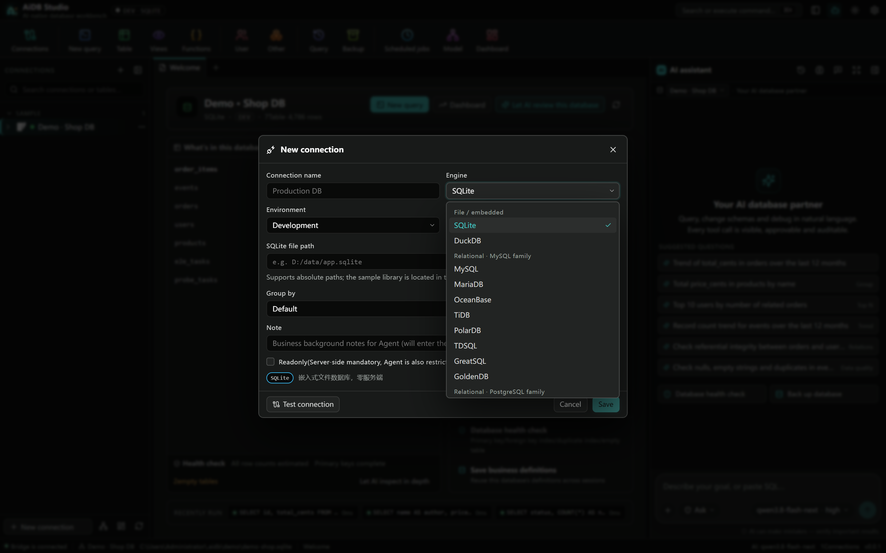

### 支持的 41 种引擎

| 家族 | 引擎 |
|---|---|
| 文件 / 嵌入式 | SQLite、DuckDB |
| MySQL 协议 | MySQL、MariaDB、OceanBase、TiDB、PolarDB、TDSQL、GBase 8a、Apache Doris、StarRocks、GreatSQL、GoldenDB |
| PostgreSQL 协议 | PostgreSQL、TimescaleDB、CockroachDB、人大金仓 KingbaseES、openGauss、华为 GaussDB、瀚高 HighGo、Vastbase、IvorySQL |
| 企业 / 列式 | SQL Server、Oracle（thin）、ClickHouse、达梦 DM8 |
| 文档 | MongoDB |
| 键值 | Redis |
| 图 | Neo4j、Memgraph、FalkorDB、ArangoDB |
| 向量 | Qdrant、Milvus、Weaviate |
| 搜索 | Elasticsearch、OpenSearch |
| 宽列 | Cassandra、ScyllaDB |
| 时序 | TDengine、InfluxDB |

协议别名复用同一驱动，但保留自己的默认端口与能力边界：例如达梦走官方 `dmdb`，DuckDB 走文件驱动，OceanBase 当前只接 MySQL 模式。对象树、查询语言、DDL、备份、用户管理、事务等能力按引擎裁剪；不支持的功能会明确禁用，而不是给出一个会失败的按钮。

> **macOS Intel 与 Windows arm64 安装包不含 Oracle 驱动。** 上游 `node-oracledb` 26 只发布 `darwin-arm64` / `linux-arm64` / `linux-x64` / `win32-x64` 四种预编译绑定，没有 `darwin-x64` 与 `win32-arm64`；thick 模式同样要加载这份绑定，所以装 Oracle Instant Client 也绕不过去。Bridge 在 `/health` 与 `/bootstrap` 的 `unavailableEngines` 里上报本机缺绑定的引擎，桌面端据此在新建连接时把 Oracle 置灰并写明原因，而不是让用户配完才发现连不上。其余 40 种引擎在这两个包上行为与其它架构一致。

### 非关系型工作台

- **MongoDB**：集合浏览、采样字段推断、`collection / op / filter / pipeline` JSON 查询、文档写入、单文档编辑、CSV 导入、集合与索引建删、TTL / unique / sparse 索引。
- **Redis**：DB 索引切换、SCAN 键浏览、String / Hash / List / Set / ZSet 查看、命令控制台、键创建。
- **Cassandra / ScyllaDB**：keyspace / table 浏览、CQL 控制台。
- **Neo4j / Memgraph / FalkorDB / ArangoDB**：节点标签与关系类型浏览、Cypher / AQL 控制台、力导向图视图。
- **Qdrant / Milvus / Weaviate**：集合与维度浏览、向量检索面板；集合生命周期、payload 索引、字段扩展按引擎能力开放。
- **Elasticsearch / OpenSearch**：索引 / mapping 浏览、`_search` JSON DSL、文档写入与索引管理。
- **TDengine**：超级表 / 子表浏览、SQL 控制台。
- **InfluxDB**：InfluxDB 3 SQL 查询、行协议写入面板。
- **PostgreSQL + pgvector**：向量检索面板与 Embedding 配置。

## 对象树与数据库操作

对象树既是用户的地图，也是 Agent 的目录。它把连接、库、Schema、表、视图、函数与备份组织成一套可导航的对象模型；用户在树上右键完成的操作，Agent 通过同一套对象与执行器完成。

对象树按 **连接 → 库 / Schema → 表 / 视图** 组织，并固定提供函数 / 存储过程、查询、备份入口。

- **快速定位**：搜索连接或对象，按分组折叠，记住展开状态；表与视图分组展示，行数估算直接显示在树上。
- **数据库右键**：关闭、编辑 / 新建 / 删除数据库、新建表、新建查询、命令列、运行 SQL 文件、转储 SQL、逆向到模型、打开仪表板、在数据库中查找、刷新。
- **表右键**：打开、新建查询、设计、新建表、重命名、复制（仅结构 / 结构 + 数据）、查看 DDL、创建快捷方式（Windows）、打印表、维护、对象信息、设置权限、导入 / 导出向导、清空、截断、删除、逆向到模型、AI 解释、AI 数据质量。
- **视图右键**：数据、新建查询、查看 DDL、打印、删除视图、AI 解释此视图。
- **连接右键**：编辑、测试、刷新、新建查询、新建表、设计、关系图、AI 数据库体检、复制名称、删除。
- **新建 / 删除数据库**：按引擎能力执行；MySQL / MariaDB 不支持重命名数据库，SQLite / Oracle 不支持新建或删除数据库，界面会说明原因。
- **对象树之外的入口**：底部提供新建连接、关系图、仪表板和刷新；顶部 Ribbon 的“表 / 视图 / 函数 / 用户 / 其它 / 自动运行”会打开对应工作区。

### 数据库与表操作

- **表维护**：分析、优化、检查、修复、回收空间等按引擎能力展示。
- **DDL 查看与复制**：表和视图都可以直接查看 DDL。
- **复制表**：仅结构或结构 + 数据。
- **清空 / 截断 / 删除**：危险操作二次确认，生产环境会强制审批。
- **导入 / 导出向导**：数据页支持导入预览与列映射，导出支持 CSV / JSON / SQL / XML / XLSX。
- **备份与恢复**：逻辑 SQL dump；设置 → 数据与备份中可恢复备份；破坏性操作前可自动备份（默认开启）。

## 数据网格

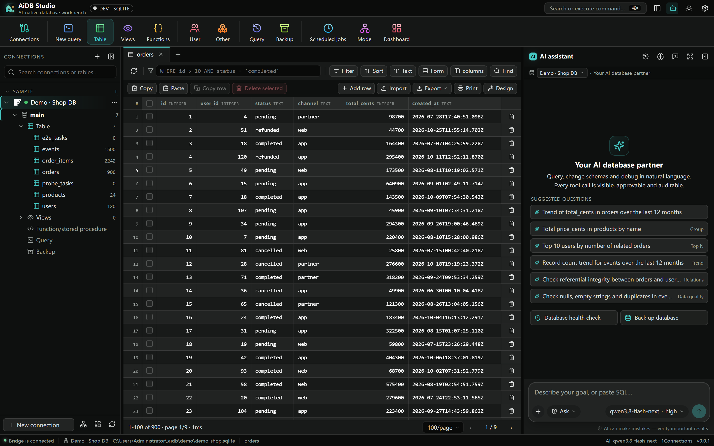

数据页是用户复核 Agent 结果的地方，也是手工修改数据的入口。二者共享同一份分页、筛选、排序和写入语义，Agent 说“改了 3 行”时，用户能在同一张网格里看见这 3 行。

数据页不是只读表格，而是一套可完成日常数据维护的网格：

- **浏览**：行号、分页、每页行数、记录区间与页码、双击/表单编辑、文本视图、表单视图（逐行编辑）。
- **定位**：WHERE 过滤、可视化筛选构建器、多列排序对话框、主键安全定位单行。
- **编辑**：新增行、删除行、行多选、复制 / 粘贴（TSV）、复制所选行到表尾、批量删除、查找替换（先预览匹配数再执行）。
- **列管理**：隐藏列、恢复全部列、列宽与内容自适应。
- **非关系型**：MongoDB 文档编辑、Redis 键值面板、向量检索、行协议写入等专用面板。
- **导入**：CSV / TSV / TXT / JSON / XML / XLSX，支持分隔符、首行表头、预览和列映射；单次最多 5000 行，批量插入。
- **导出**：CSV / JSON / SQL / XML / XLSX；大表按上限导出。
- **打印**：生成打印预览，可在浏览器/Electron 中打印或另存为 PDF。
- **错误处理**：写失败保留原始错误与当前编辑状态，不会静默丢数据。

## SQL 工作台

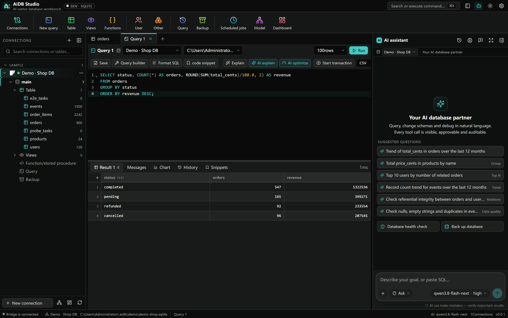

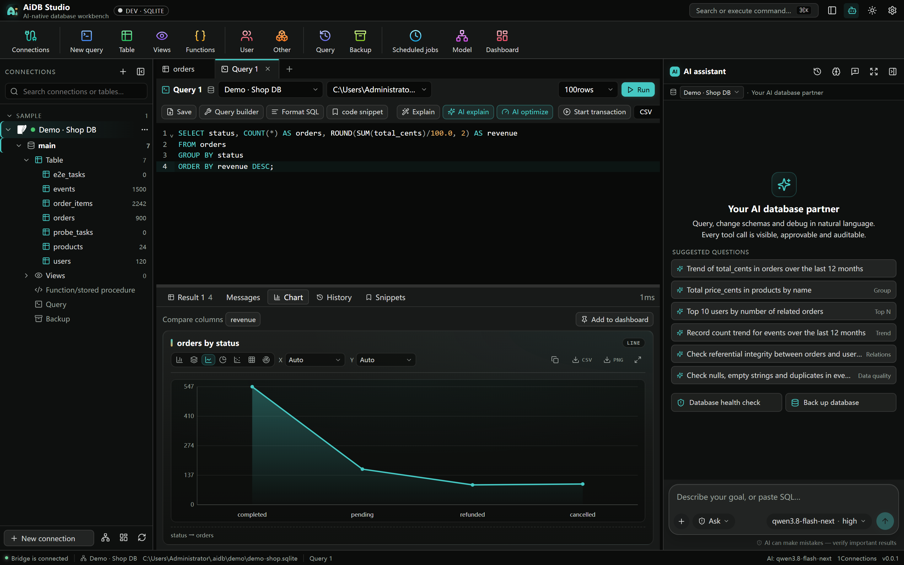

SQL 仍然是数据库工作的硬通货。AiDB 不隐藏 SQL，而是把它变成 Agent 与用户共同编辑、共同验证的语言：Agent 写下的语句可以落回编辑器，用户选中的 SQL 也可以随时交给 Agent 解释或优化。

- **编辑器**：CodeMirror 6，按方言高亮（SQLite / MySQL / PostgreSQL / SQL Server / Oracle / ClickHouse；其余按标准 SQL），自动补全当前连接的表与列。
- **执行**：`⌘/Ctrl + Enter` 执行当前语句，选中文本时只执行选中部分；可执行整段脚本；多结果集；消息面板；可选自动 LIMIT 与多语句开关。
- **连接与库**：页内直接切换连接和库，使用当前库的表结构做补全。
- **事务**：支持 `BEGIN / COMMIT / ROLLBACK` 的引擎可在页内开始事务、提交、回滚；事务在 Bridge 端保持同一条连接。
- **结果**：
  - 表格结果，支持复制、多结果集和导出 CSV / JSON / SQL / XML / XLSX；
  - 图表结果，支持柱状 / 堆叠 / 折线 / 饼 / 散点 / 热力 / 雷达，可切换 X / Y、添加对比列、双轴、导出 CSV / PNG、放大、打开背后的 SQL；
  - 图数据库结果自动切换为图视图；
  - 查询结果可一键钉到当前库的仪表板。
- **辅助**：美化 SQL、执行计划、查询历史（搜索 / 收藏 / 回填）、SQL 片段库、保存 / 打开 `.sql` 文件、可视化查询构建器。
- **AI Copilot**：选中 SQL 后可“AI 解释”或“AI 优化”，自动把 SQL 送入 Agent，输出改写 SQL、精确索引 DDL 与验证查询。
- **多语言模式**：MongoDB 自动切换为 MQL JSON，Redis 为命令模式，图数据库为 Cypher / AQL，Cassandra 为 CQL，搜索为 `_search` DSL，向量库为向量检索 JSON；SQL 专属工具会隐藏。

## 表设计器与关系图

结构变更不是一句 DDL，而是一次需要预览、确认与执行前复核的工程动作。设计器把列、索引、外键、触发器和选项变成可复核的模型，关系图则把表之间的依赖关系画出来。

- **可视化表设计**：字段、索引、外键、触发器、选项、注释、SQL 预览七个选项卡。
- **DDL 实时预览**：修改列、类型、默认值、可空、注释、索引后实时生成目标方言 DDL；执行前可复核。
- **并发结构变更**：检测到外部结构变化时提示重新加载或保留本地编辑，避免无提示覆盖。
- **关系图**：基于外键的只读 ER 视图，表结构卡片 + 连线；点击表进入数据；支持导出 SVG。
- **模型入口**：连接 / 数据库 / 表的右键都可“逆向到模型”。

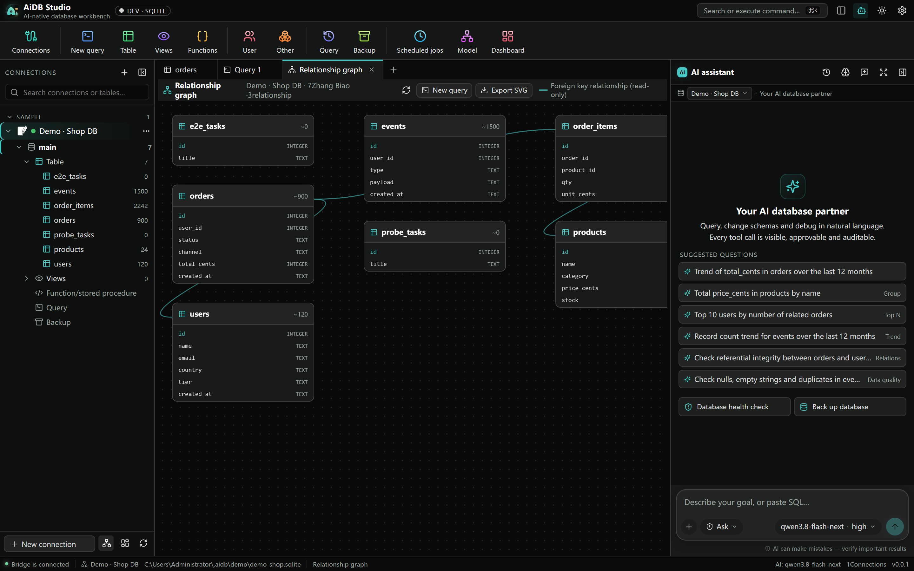

## 仪表板

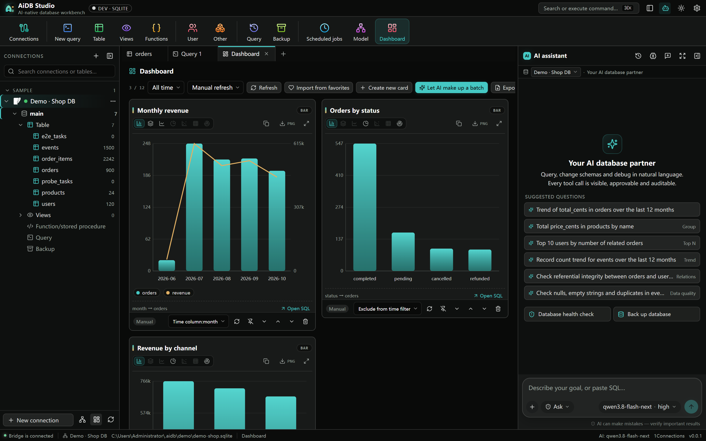

仪表板把 Agent 的分析从一次回答变成可持续观察的卡片。它仍然保存 SQL，而不是截图；打开时先渲染上次快照，再后台重跑，让结论始终跟着数据库变化。

仪表板是 **这个库的常用问题面板**，不是 BI 画布：

- **按库隔离**：作用域是 `connectionId + database`，每个库一块板。
- **活的卡片**：卡片保存 SQL，不保存截图；打开先渲染上次结果快照，再后台重新执行。
- **AI 草稿与固定卡**：AI 生成的是草稿（`pinned = 0`），可以整批丢弃；用户固定卡（`pinned = 1`）永远不会被 AI 覆盖。
- **三种来源**：让 AI 补一批、从收藏的查询导入、手写 SQL 新建；支持一句需求生成单卡并试跑。
- **板级控制**：全部时间 / 近 7 天 / 近 30 天 / 近 90 天 / 近 1 年；定时刷新（5 分钟 / 30 分钟 / 2 小时 / 每天）；单卡刷新、加宽 / 变窄、置顶、删除。
- **导出汇报**：把当前卡片结果整理成分页报告（PPTX），或走 `/report` 做更完整的业务报告。
- **只读护栏**：仪表板 SQL 必须是只读，自动 LIMIT，禁用表会被执行层拦截；所有卡片元数据只写入 `~/.aidb`，不写目标库。

## 工具箱

工具箱位于 Ribbon 的“其它”，14 个模块共用同一套 Bridge 与权限模型。每个模块都有一份能力契约，声明字段、类型、约束与状态，同时驱动 Agent 能力目录、REST 参数校验与 UI 表单渲染。

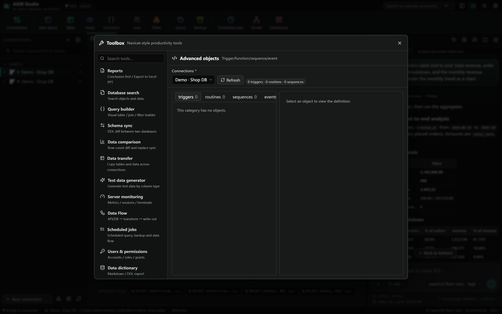

这意味着 Agent 不只是“看见有这些按钮”，而是知道每个模块需要什么参数、会返回什么状态、哪些操作必须由用户亲自完成。能力契约把“模型能不能用”和“功能是否存在”分开，避免模型编造一个不存在的接口。

| 模块 | 能力 | Agent 可用性 |
|---|---|---|
| 报告 | 按主题、时间范围、阅读对象生成结论先行的报告；保存、刷新、导出 Excel / PPT | `/report` 命令 + 命令私有工具 |
| 数据库搜索 | 对象名 / 注释 + 数据文本列全文查找，结果可直接打开 | `search_objects`（仅对象名） |
| 查询构建器 | 选表、连接、列、WHERE、排序、行数，生成 SQL 送入编辑器 | 无专用工具（`run_sql` 等价） |
| 结构对比同步 | 两连接 DDL diff，生成目标方言语，确认后执行同步 | `schema_diff`（仅对比） |
| 数据对比 | 行数 + 主键指纹差异，按表替换同步 | 无专用工具（`recon_data` 覆盖行级对账） |
| 数据传输 | 跨连接复制表结构与数据，自动建表，追加 / 清空后写入 | `transfer_data` |
| 数据生成 | 按列语义、类型与外键造 1–5000 行测试数据，预览后插入 | `generate_data` |
| 数据流处理 | 从接口或 SQL 取数，用 JSONPath / 表达式清洗，在内置 DuckDB 或 JS / Python 脚本里计算，再写回表或推送接口；支持单步试运行与增量断点 | `manage_pipeline` |
| 服务器监控 | 引擎指标、会话列表，10s 刷新，终止会话 | 无 |
| 自动化任务 | 定时 SQL / 备份 / 数据流任务，最小 30s 间隔，立即运行、启停、状态 | 无 |
| 用户与权限 | 账户 / 角色列表、创建、删除、授权 | 无 |
| 数据字典 | Markdown / DDL / JSON 导出，含列类型、默认值、注释 | 无 |
| 高级对象 | 触发器 / 函数 / 存储过程 / 序列 / 事件及定义查看 | 无 |
| Agent 上下文 | 表 / 列启用状态、业务别名、描述、手工关联与术语 | 读取隐式注入；写入刻意不开放 |

没有 Agent 工具的功能不会让模型假装能执行：能力目录会要求它引导用户到对应工具箱模块操作。

## 移动端

Agent 不应该被固定在桌面。移动端通过 Bridge 把同一个 Agent 带到手机上：同一份连接、会话、记忆、模型与权限，在通勤、会议或现场也能继续完成任务。

移动端不是桌面端的缩小版，而是一套完整的随身工作区。

<p align="center">
  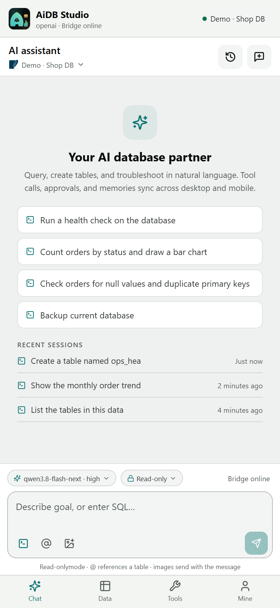
  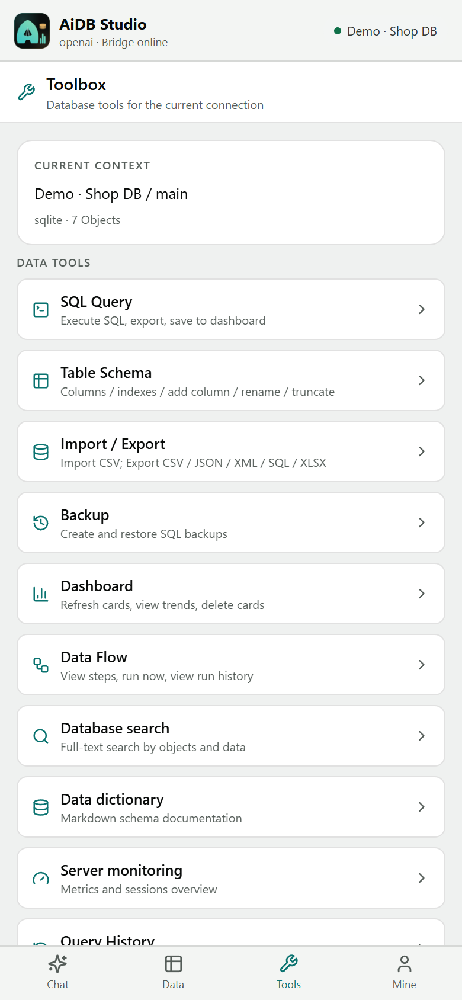
  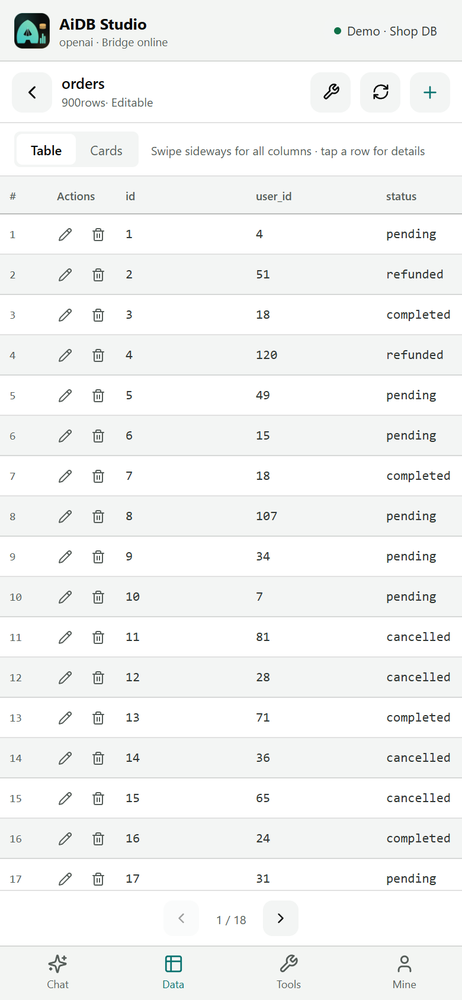
</p>

- **配对**：二维码、6 位配对码、`aidb://pair` 深链、mDNS 原生发现 / 同网段扫描；凭据只保存在设备安全存储。
- **一级导航**：对话 / 数据 / 工具 / 我的。
- **对话**：模型与思考档位、权限模式、数据库切换、@ 引用表、图片附件、会话搜索 / 改名 / 删除 / 归档、记忆增删改查。
- **数据**：连接 + 数据库选择、表格 / 卡片视图、横滑查看全部列、按主键编辑 / 删除行、新增行、分页。
- **工具（12 个数据库工具）**：SQL 查询、表结构、导入 / 导出、备份、仪表板、数据库搜索、数据字典、服务器监控、查询历史、审计日志、报告与产物、用户与权限。
- **SQL**：多语句开关、结果表格、CSV / JSON / XML / SQL / XLSX 导出、存为仪表板卡片。
- **表结构**：列 / 索引查看、加列、建 / 删索引、重命名、清空、删除表、可视化建表。
- **导入 / 导出**：CSV 导入；CSV / JSON / XML / SQL / XLSX 导出；Web 下载，原生分享。
- **备份**：备份列表、立即备份、恢复（二次确认）。
- **仪表板**：卡片列表、刷新、迷你趋势、删除；卡片布局编辑仍在桌面端。
- **报告与产物**：查看规格 / 运行结果、导出 XLSX / PPTX、删除。
- **命令工作流**：按命令定义渲染数据源、参数、枚举 / 布尔，启动并轮询结果。
- **我的**：连接列表、记忆、已配对设备、主题（深 / 浅 / 跟随系统）、语言（中 / 英）、Skills / MCP 开关、解除配对。
- **图表**：柱 / 折线 / 饼 / 散点 / 热力 / 雷达，使用与桌面一致的色板和热力色阶。
- **默认只读**：移动端默认以只读权限开始，可显式切换；数据库凭据从不下发到设备。

> 浏览器扫码需要 HTTPS（或 localhost）；局域网 HTTP 页面请手动输入 Bridge 地址，或把 Bridge 放到 TLS 反向代理之后。

## 设置

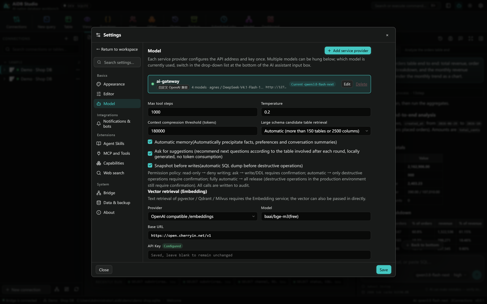

设置决定 Agent 的视野、力度与边界：用哪个模型思考、能走多少步、是否自动记忆、写前是否备份、哪些 Skill 与 MCP 可用、搜索结果从哪里来。它不是偏好页，而是 Agent 行为的一部分。

设置分为 11 个部分：

| 分区 | 内容 |
|---|---|
| 外观 | 深色 / 浅色 / 跟随系统，中文 / English |
| 编辑器 | 默认行数、查询超时、历史保留数量 / 天数、多语句开关、自动 LIMIT |
| 模型 | 服务商与多模型、API 地址 / 密钥、模型档案（上下文、输出、图片、推理档位）、温度、最大步数、自动记忆、追问建议、写前备份、大 schema 检索、Embedding |
| 通知与机器人 | 飞书、企业微信、钉钉、Slack、Discord、Telegram、QQ（OneBot）出站；飞书 / OneBot 入站只读问答 |
| Agent Skills | 启用 / 禁用、安装、查看文件、运行任务、密钥、输出文件 |
| MCP 与工具 | stdio MCP Server、3 个内置 Server、Agent 工具目录 |
| 功能能力 | 13 份能力契约的字段、状态与工具映射 |
| 网络搜索 | 12 个搜索后端的启用、密钥、代理、健康遥测与探测 |
| Bridge | 移动端配对二维码 / 配对码、已配对设备、吊销 |
| 数据与备份 | 最近审计、导出审计 CSV、备份列表、恢复备份 |
| 关于 | 版本、许可、依赖 |

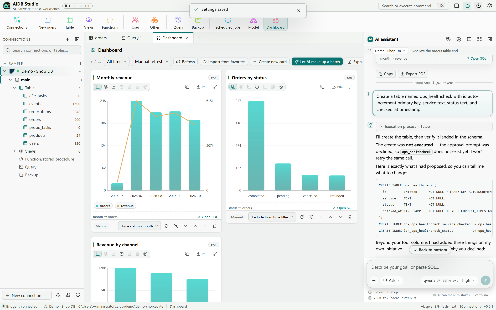

## 集成：通知、Skill、MCP、网络搜索

Agent 的价值不止于数据库内部。通知、Skill、MCP 与网络搜索把它的行动半径延伸到外部系统，同时把权限和审计留在 Bridge 内。

### 通知与机器人

- **出站 7 个平台**：飞书、企业微信、钉钉、Slack、Discord、Telegram、QQ（OneBot HTTP）。
- **入站只读问答**：飞书事件回调与 OneBot 消息事件可触发只读 Agent，原路回复；企业微信暂不支持入站。
- **定时报告**：产物完成后按绑定的通知渠道发送摘要；单渠道失败不影响其它渠道。
- **审计**：每次发送记录 `notification.send`。

### Agent Skills

- **内置技能**：报告写作、SQL 审查、数据字典，首次启动自动安装。
- **导入方式**：本地目录、zip、Git 仓库、npm 包；每个 Skill 包含 `SKILL.md`。
- **运行**：Skill Host 提供文件读写、进程、Python 包与网络权限的声明式沙箱；支持 Worker 子 Agent、密钥注入和输出文件。
- **PPT Master**：一键安装第三方 Skill 后，报告可生成原生 PPTX，含品牌模板与质量门禁。
- **开关**：设置 → Agent Skills 总开关；关闭后技能仍可管理，但 Agent 不再获得 Skill 工具。

### MCP

- **外部 MCP Server**：stdio JSON-RPC，懒启动、进程复用；支持工具发现与调用。
- **3 个内置 Server**：
  - `builtin-filesystem`：目录白名单、realpath 校验、读写上限；`grep_files` 优先走 ripgrep；
  - `builtin-git`：只读 `status / log / diff / show`，固定参数白名单；
  - `builtin-web`：`fetch_url` / `web_search`，拦截 loopback、内网、链路本地和云元数据地址。
- **AiDB 作为 MCP Server（出站）**：`scripts/aidb-mcp-server.mjs` 可把 AiDB 的只读工具暴露给外部 MCP 客户端。
- **工具目录**：设置 → MCP 与工具中可搜索、按分组查看全部 53 个 Agent 工具及其风险约束。

### 网络搜索

12 个后端并发 fan-out：

- 免密钥：Exa、Parallel（MCP）、Bing（RSS）、DuckDuckGo（HTML，需代理）、SearXNG（需自建）；
- 填 Key：Brave、Tavily、Serper、Mojeek、DeepSeek、Anthropic、OpenAI。

结果 URL 去重、相关性重排；单后端失败隔离；每个后端有健康遥测和一键探测；失败原因会区分 DNS、超时、代理等问题。默认只启用实测可达的 Exa / Parallel / Bing，其余按需开启。

## 安装包

release 页按「系统 + 架构」出包，六个桌面组合：

| 系统 | 架构 | 安装包 |
|---|---|---|
| Windows | x64 | `AiDB-Studio-<版本>-x64-setup.exe`（NSIS） |
| Windows | arm64 | `AiDB-Studio-<版本>-arm64-setup.exe`（NSIS） |
| macOS | Apple Silicon | `AiDB-Studio-<版本>-arm64.dmg` |
| macOS | Intel | `AiDB-Studio-<版本>-x64.dmg` |
| Linux | x64 | `AiDB-Studio-<版本>-x86_64.AppImage` / `-amd64.deb` / `-x86_64.rpm` |
| Linux | arm64 | `AiDB-Studio-<版本>-arm64.AppImage` / `-arm64.deb` / `-aarch64.rpm` |

- Windows on ARM 也能直接跑 x64 安装包（系统模拟），而那份保留 Oracle 驱动。
- Linux 的文件名按发行版惯例带架构后缀（x64 是 `amd64` / `x86_64`，arm64 是 `aarch64`）。deb / rpm 走发行版包管理器；AppImage 免安装但需要 FUSE 2，没有就 `--appimage-extract-and-run`。两者都需要图形会话，WSL2 需要 WSLg。
- 每个安装包只带自身架构的原生绑定（DuckDB、node-oracledb），CI 在发布前逐个断言；两个例外见上文引擎说明。
- Android / iOS 走 EAS 构建，不在 release 里。

### 检查更新

「设置 → 关于」里有版本更新卡片：检查 GitHub 上是否有新版本，并按当前安装形态决定「自己下载安装」还是「跳转下载页」。

| 安装形态 | 行为 | 原因 |
|---|---|---|
| Windows（NSIS） | 下载并静默安装，支持差分下载（`latest.yml` + blockmap，通常几十 KB 而非整包） | 安装器支持 `/S`，且当前目录可写 |
| Linux（AppImage） | 同上，按 `latest-linux.yml` / `latest-linux-arm64.yml` 取包 | 只有 AppImage 能自我替换 |
| Linux（deb / rpm） | 跳转下载页 | `/opt` 由包管理器接管，应用无权覆盖 |
| macOS | 跳转下载页 | 构建未签名，Squirrel.Mac 拒绝替换未签名的 app |
| 开发态 / 网页版 | 只检查版本，不提供安装 | 没有 `app-update.yml`，也没有安装包可换 |

自动更新依赖 release 里的 `latest*.yml`（版本、文件名、sha512）。Windows 的元数据不带架构后缀，所以 arm64 走独立通道 `latest-arm64.yml`，客户端按 `process.arch` 选同名文件；Linux 的文件名由 electron-updater 自己加 `-linux-arm64` 后坠。安装包文件名统一用连字符（`AiDB-Studio-...`）：electron-builder 写元数据时会把空格换成 `-`，而 GitHub 上传时会把空格换成 `.`，两边不一致会让下载地址 404。

## 架构

```
apps/desktop     Electron 45 + React 18 + Vite 6（也可纯浏览器运行）
apps/gateway     Bridge：驱动、元数据库、REST / SSE / WS、Agent 宿主、调度器
apps/mobile      Expo SDK 52 / React Native 0.76（Android / iOS / Web）
packages/core    平台无关内核：SQL 分类与方言、DDL、Agent 运行时、工具、权限、记忆、Provider、能力契约
docs/            设计文档、验证报告、截图
scripts/         文档契约、种子、E2E、QA、独立 MCP Server
```

- **Bridge**：本地网关，管理连接、驱动、元数据、执行器和 Agent 运行时；桌面端内置，也可以独立部署。
- **元数据**：默认在 `~/.aidb/aidb.db`（连接、会话、记忆、产物、仪表板、审计、Skill、MCP、通知、设备）；示例库在 `~/.aidb/demo`；导出与备份在 `~/.aidb/exports` / `~/.aidb/backups`。
- **传输**：REST + SSE（桌面 / Web）+ WebSocket（移动端与结构变更事件）。
- **执行**：手工操作、Agent 工具、命令工作流、仪表板、报告共用同一套 ConnectionManager / ToolExecutor / 策略层。
- **移动端**：不直连数据库，只通过 Bridge 的 REST / WS 访问；连接凭据保留在 Bridge。

Docker 独立部署 Bridge：

```bash
docker build -f apps/gateway/Dockerfile -t aidb-bridge .
docker run -p 8787:8787 -v aidb-data:/data \
  -e AIDB_TOKEN=change-me \
  -e AIDB_PUBLIC_URL=https://db.example.com \
  aidb-bridge
```

## 命令

| 命令 | 说明 |
|---|---|
| `npm run dev` | Bridge（tsx 热重载）+ Vite UI |
| `npm run dev:desktop` | Bridge + Vite + Electron |
| `npm run seed` | 创建 / 校验内置示例 SQLite 库 |
| `npm run seed:business` | 生成零售业务库与镜像库（含结构漂移与行级差异） |
| `npm run typecheck` | 四个 workspace 全量类型检查 |
| `npm test` | Core 单测 + Bridge 集成测试 |
| `npm run build` | Core / Bridge bundle / 桌面 UI / 移动 Web |
| `npm run build:desktop` | Electron 安装包（Windows NSIS / macOS dmg / Linux AppImage + deb + rpm，各含 x64 与 arm64） |
| `npm run build:mobile` | Expo Web 导出 |
| `npm run e2e` | 无头浏览器：桌面 Web + 移动 Web + Electron Shell |
| `npm run verify:docs` | 设计文档契约 |
| `npm run verify:controls` | 表单控件审计 |
| `npm run verify` | 文档契约 → 控件 → 类型 → 测试 → 构建 → E2E |
| `npm run bench` | Agent 准确率基准 |

## 安全模型

AiDB 把安全做成 Agent 的一部分，而不是事后补丁。只读、审批、备份与审计都不是提示词约束，而是执行器的硬边界。

- **网络边界**：Bridge 默认只监听 `127.0.0.1`；移动端通过 6 位配对码换取可吊销的设备令牌；`/pair/claim` 按来源限流。
- **凭据**：连接密码、SSH 私钥、模型密钥、Webhook、MCP 环境变量使用 AES-256-GCM 加密；独立 Bridge 由 `AIDB_SECRET` 派生密钥。
- **数据库边界**：只读连接服务端强制；SQL 静态分类；自动 LIMIT；多语句默认拒绝；生产环境破坏性操作强制审批。
- **Agent 边界**：无 shell；文件系统受目录白名单限制；网络仅模型 API / 搜索后端 / Web MCP；所有工具调用经策略层。
- **Skill / MCP 边界**：Skill 运行在声明式权限沙箱；MCP 外部 Server 需要显式配置；内置 filesystem / git / web 有路径、命令、域名和大小限制。
- **可追溯**：手工操作与 Agent 操作都写入审计；审批、耗时、风险等级、影响 SQL 可查、可导出 CSV。

反向代理示例（Nginx 将 `https://db.example.com` 转到 `127.0.0.1:8787`）：

```nginx
location / {
  proxy_pass http://127.0.0.1:8787;
  proxy_http_version 1.1;
  proxy_set_header Host $host;
  proxy_set_header X-Forwarded-Proto $scheme;
  proxy_set_header Upgrade $http_upgrade;
  proxy_set_header Connection "upgrade";
  proxy_read_timeout 900s;
  proxy_buffering off; # Agent 的 SSE 流
}
```

启动 Bridge 时设置 `AIDB_PUBLIC_URL=https://db.example.com`，配对二维码与提示地址即可直接使用公网地址。

## 设计边界

- AiDB Studio 是 Navicat 式数据库客户端，不是 BI 平台：仪表板是每个库的常用问题面板，不做自由拖拽画布、下钻联动或跨源 JOIN。
- 移动端是随身工作区：连接凭据不下发、复杂布局编辑和部分管理能力仍在桌面端。
- 图数据库、向量库、搜索、时序、宽列等引擎按各自查询语言工作，不强行套用 SQL 语义；不支持的 DDL、备份、用户管理等能力会禁用。
- 数据编辑当前即时提交；跨请求事务在支持的 SQL 引擎上通过 `BEGIN / COMMIT / ROLLBACK` 完成。
- 桌面端按「系统 + 架构」产出六个安装包（Windows / macOS / Linux × x64 / arm64）；macOS Intel 与 Windows arm64 不含 Oracle 驱动，原因见上文引擎说明。移动端 IPA / APK 需要 EAS 构建，不在 release 流水线内。

## 设计文档

- [产品总览](docs/00-product-overview.md)
- [技术架构](docs/01-tech-architecture.md)
- [功能规格](docs/02-feature-spec.md)
- [UI/UX 设计](docs/03-ui-ux-design.md)
- [AI Agent 设计](docs/04-ai-agent-design.md)
- [数据模型与协议](docs/05-data-and-api.md)
- [交付与验证](docs/06-delivery-and-verification.md)
- [验证报告](docs/07-verification-report.md)
- [Agent 准确率计划](docs/08-agent-accuracy-plan.md)
- [多引擎架构](docs/09-multi-engine.md)
- [真实 MySQL 只读回归](docs/10-real-mysql-readonly-regression.md)
- [命令化 Agent 工作流](docs/11-command-workflows.md)
- [机器人与 MCP 插件](docs/12-bots-and-mcp.md)
- [Skill Host 设计](docs/13-skill-host-plan.md)
- [仪表板设计](docs/14-dashboard-design.md)
- [命令作用域](docs/15-command-scoping.md)
- [功能能力契约](docs/16-capability-contract.md)
- [欢迎页设计](docs/17-welcome-home-design.md)
- [首页与 Agent 解耦](docs/18-agent-home-decoupling.md)
- [结构变更事件](docs/19-schema-change-events.md)

## License

MIT
