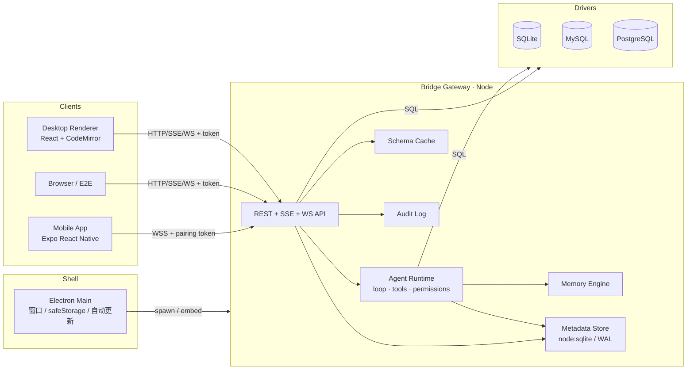
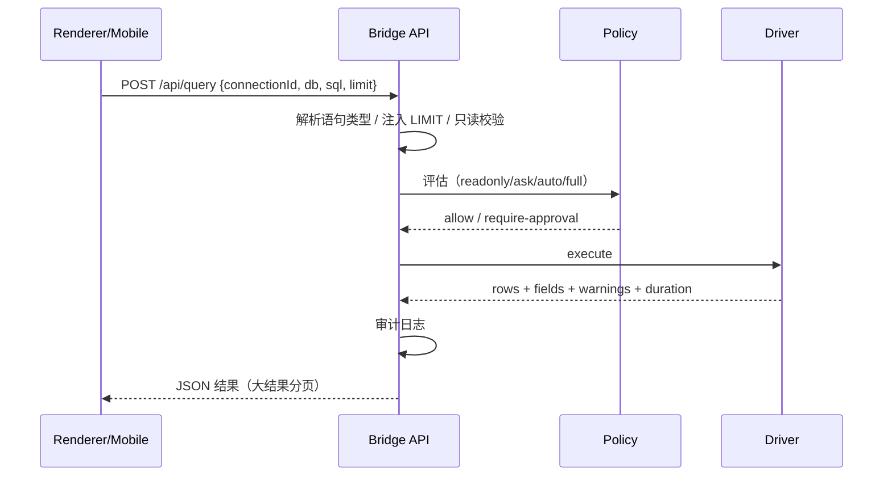
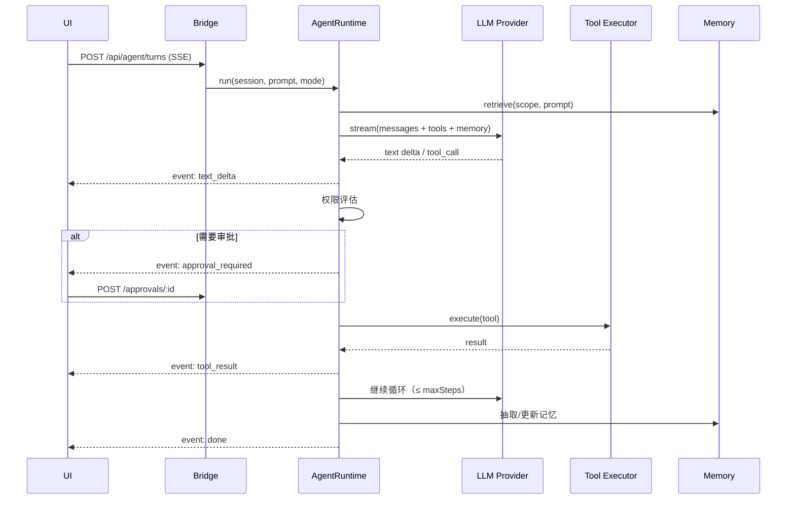

# AiDB Studio — 技术架构设计

> 版本：v0.3 · 关联：[产品总览](./00-product-overview.md) · [AI Agent](./04-ai-agent-design.md)

## 1. 关键决策（ADR 摘要）

| # | 决策 | 选择 | 放弃方案 | 理由 |
|---|---|---|---|---|
| D1 | 桌面壳 | **Electron 45** | Tauri 2 | 需要 Node 驱动（mysql2/pg/ssh2）与长驻 Bridge；Electron 45 内置 Node 24，支持 `node:sqlite`；跨三平台一致，团队成本最低。Tauri 体积更小但驱动需 Rust 侧实现或 sidecar，复杂度转移。 |
| D2 | 移动端 | **Expo (React Native) SDK 52 + expo-router** | Flutter / Capacitor | 与 Web 共享 TS 类型与 Agent 协议；expo-sqlite/SecureStore 原生能力完善；EAS 可构建 Android/iOS。Capacitor 对 DB 网络层限制多，Flutter 无法复用 TS 内核。 |
| D3 | 代码组织 | **npm workspaces 单仓多包** | 多仓 | 核心协议、Agent、SQL 工具在桌面/移动/Bridge 间共享，单仓保证版本一致。 |
| D4 | Agent 运行位置 | **Bridge 服务端（Node）** | 渲染进程 / 移动端本地 | 工具执行需要数据库驱动与文件系统；服务端单点执行便于审计、移动端复用、防止渲染层被注入后直接操作 DB。 |
| D5 | 元数据存储 | **SQLite（Node 内置 `node:sqlite`）** | better-sqlite3 / 文件 JSON | Node ≥22.5 内置、零原生编译；要求 Electron ≥45（内置 Node 24），否则打包运行时缺少该模块。WAL 并发足够。 |
| D6 | 驱动 | `node:sqlite` + `mysql2` + `pg` + `mssql` + `oracledb` (thin) + ClickHouse HTTP + `mongodb` + `ioredis` + `neo4j-driver` + `dmdb` + `@duckdb/node-api` + Qdrant/Milvus REST | ORM / Prisma | 数据库工具需要原始 SQL/命令、多库方言、任意 DDL；ORM 反而阻碍。MariaDB/CockroachDB 与国产协议别名复用 MySQL/PG 驱动；MongoDB/Redis/Neo4j/向量库走结构化查询与命令分类；达梦 DM8 使用官方 dmdb。 |
| D7 | 桌面 ↔ Bridge | **REST + SSE + WebSocket**，统一为 `BridgeClient` | Electron IPC | 同一协议同时服务桌面 Web 形态、移动端与远程 Bridge；Electron 只做窗口壳，验证时可直接用浏览器跑，E2E 成本低。 |
| D8 | 编辑器 | **CodeMirror 6** | Monaco | 体积小、启动快、移动 Web 兼容、方言扩展易定制。 |
| D9 | 状态管理 | **Zustand + 自研 SSE 事件总线** | Redux | 轻量，store 切片清晰，配合流式事件简单。 |
| D10 | 样式 | **原生 CSS + Design Tokens（CSS 变量）** | Tailwind | 精细控制桌面密度与主题切换；移动端单独 RN StyleSheet，共享 token 数值常量。 |
| D11 | AI Provider | **Anthropic Messages、OpenAI Chat Completions（兼容）+ 内置 Local Reasoner** | 单一云厂商 | 用户可接 Ollama/DeepSeek/Qwen；无 Key 也能演示与可用。 |
| D12 | 密钥 | Electron `safeStorage` 加密，Bridge 独立部署用 `AIDB_SECRET`；移动端 SecureStore | 明文配置 | 避免凭据泄露。 |
| D13 | 测试 | `node:test`（core/网关）+ Playwright（桌面 Web 形态）+ `tsc --noEmit` + Expo Web 冒烟 | 仅手工 | 可在 CI 与本地无头环境复现。 |

## 2. 仓库结构

```
ai-db/
├─ docs/                       # 设计文档 + 验证报告
├─ packages/
│  └─ core/                    # 平台无关内核（TS）
│     ├─ src/types.ts          # 领域模型 / 协议 DTO
│     ├─ src/sql/              # 分类器、方言、DDL/DML 构造、格式化
│     ├─ src/agent/            # 运行时、工具、提示词、记忆、Provider、离线推理
│     └─ src/protocol.ts       # HTTP/WS/SSE 消息协议
├─ apps/
│  ├─ gateway/                 # Bridge：驱动、元数据库、REST/SSE/WS、Agent 宿主
│  ├─ desktop/                 # Electron main + React 渲染层（含 Web 独立运行）
│  └─ mobile/                  # Expo RN 客户端
├─ scripts/                    # 文档/契约验证、种子数据、E2E
└─ package.json                # workspaces + 顶层脚本
```

### 2.1 数据库引擎矩阵

| 引擎 | 驱动 | 方言要点 | 状态 |
|---|---|---|---|
| SQLite | `node:sqlite` | AUTOINCREMENT、`EXPLAIN QUERY PLAN` | 真实集成验证 |
| MySQL / MariaDB | `mysql2` | 反引号、AUTO_INCREMENT、`EXPLAIN FORMAT=JSON` | 方言测试 |
| PostgreSQL / CockroachDB | `pg` | 双引号、SERIAL、`EXPLAIN (FORMAT JSON)`、CASCADE | 方言测试 |
| SQL Server | `mssql` (tedious) | `[ident]`、IDENTITY、OFFSET/FETCH | 方言测试 |
| Oracle | `oracledb` thin | 大写标识符、IDENTITY、OFFSET/FETCH、DBMS_XPLAN | 方言测试 |
| ClickHouse | HTTP | 反引号、MergeTree、`EXPLAIN`、JSONCompact | 方言测试 |

所有驱动实现统一 `Driver` 接口（test / listDatabases / describe / run / runParams / close），新增引擎只需实现接口与方言映射。

## 3. 系统架构



**要点**
- Electron 不承载业务：启动时在本机 `127.0.0.1` 随机端口拉起 Bridge（同进程 import），注入一次性 token，再加载渲染层。开发/验证时 Bridge 可独立启动，用浏览器访问 Vite 页面。
- Agent 的工具执行与普通查询共用同一执行器与安全策略，保证"AI 能做的 = 用户能做的"，反之亦然。
- 元数据（连接、历史、会话、记忆、审计）只存在于 Bridge 侧 SQLite，多端天然一致。

## 4. 关键流程

### 4.1 执行 SQL


### 4.2 Agent 回合


## 5. 多端交付

| 交付物 | 命令 | 产物 |
|---|---|---|
| 开发（Web 验证形态） | `npm run dev` | Vite :5180 + Bridge :8787 |
| 桌面开发 | `npm run dev:desktop` | Electron 窗口（加载 Vite） |
| 桌面打包 | `npm run build:desktop` | Windows NSIS / macOS dmg / Linux AppImage |
| Bridge 独立部署 | `npm run build:gateway && node apps/gateway/dist/index.js` | Linux 可运行服务 + Dockerfile |
| 移动开发 | `npm --workspace apps/mobile run start` | Expo Go / 模拟器 |
| 移动构建 | `eas build -p android|ios` | AAB / IPA |
| 全量校验 | `npm run verify` | 类型检查 + 单测 + E2E + 文档契约 |

Electron 打包配置集中在 `apps/desktop/electron-builder.yml`；Bridge 以 sidecar 形式随包分发（`extraResources`，含外部 `ssh2` 依赖），移动端不内置驱动。Bridge 使用 esbuild 打包为单文件 ESM。

## 6. 安全模型

1. **网络**：Bridge 默认仅监听 `127.0.0.1`；远程模式需显式 `--host` + TLS（反向代理）或内网信任；所有请求需 Bearer token（桌面一次性 token，移动端配对后长期 token 可撤销）。
2. **配对**：移动端扫描桌面显示的一次性 6 位码 + 二维码（内含 host/port），交换为设备 token；设备可在设置中吊销。
3. **凭据**：连接密码/SSH 私钥使用 Electron safeStorage（Win DPAPI / mac Keychain / Linux libsecret）；独立 Bridge 用 `AIDB_SECRET` 派生密钥 AES-256-GCM；移动端 SecureStore。API Key 同样处理。
4. **SQL 安全**：静态分类（read/write/ddl/destructive）；`readonly` 模式仅允许 SELECT/EXPLAIN/SHOW/PRAGMA 白名单；自动追加 LIMIT；多语句默认拒绝执行（可配置）；超时（默认 30s）；标识符引用防注入（DDL 构造器）。
5. **破坏性操作**：DROP/TRUNCATE/无 WHERE 的 UPDATE/DELETE/删列 → 在 `ask`/`auto` 下强制审批；`full` 模式也写审计并在 UI 顶部显红。
6. **审计**：所有工具/查询记录 `audit_log`（who=user|agent, sql, connection, result summary, approval, duration）。可导出。
7. **移动端默认**：`readonly`，可在桌面 Bridge 策略中对设备授权。

## 7. 性能设计

- 结果集：服务端游标分页（LIMIT/OFFSET 或 keyset），前端虚拟滚动；>5 万行时提示"仅预览"。
- Schema：按连接+库缓存 30s，DDL 后失效；对象树懒加载。
- Agent 上下文：schema 摘要压缩（表名+列名+类型，仅相关表），会话 token 超过阈值触发滚动摘要（compaction）。
- 流式：SSE 事件批量合并（16ms）；UI 增量渲染，Markdown 节流解析。
- 元数据库 WAL + 预处理语句 + 索引（session_id, scope, updated_at）。

## 8. 可扩展点

- `Driver` 接口（connect/test/query/execute/describe/listDatabases/backup/close）→ 新增 Oracle/SQL Server/Mongo。
- `Provider` 接口（stream(messages, tools)）→ 新增模型。
- `Tool` 注册表（JSON Schema + handler + risk 分类）→ 新增 Agent 能力。
- `MemoryStore` 接口（lexical/vector 混合检索）→ 新增嵌入模型。
- 主题 token → 新皮肤；i18n 字典 → 新语言。

## 9. 风险与缓解

| 风险 | 影响 | 缓解 |
|---|---|---|
| Node 内置 SQLite 标记 experimental / Electron Node 版本过低 | 桌面无法启动 Bridge | 桌面锁定 Electron 45（Node 24.22）；已在真实打包产物验证；必要时切 better-sqlite3 |
| Electron 体积大 | 分发 | 文档说明；后续评估 Tauri sidecar |
| 移动端连数据库网络受限 | 核心价值受限 | Bridge 远程模式 + 只读体验库；企业内网部署 |
| 无 API Key | Agent 无法真实推理 | Local Reasoner 覆盖演示/基础查询；引导配置 |
| 大库 schema 超上下文 | 成本/质量 | 相关表检索 + 摘要压缩 + 手动 @ 选择 |
| 破坏性操作误执行 | 数据事故 | 审批 + 备份 + 事务 + 审计（默认 ask） |
